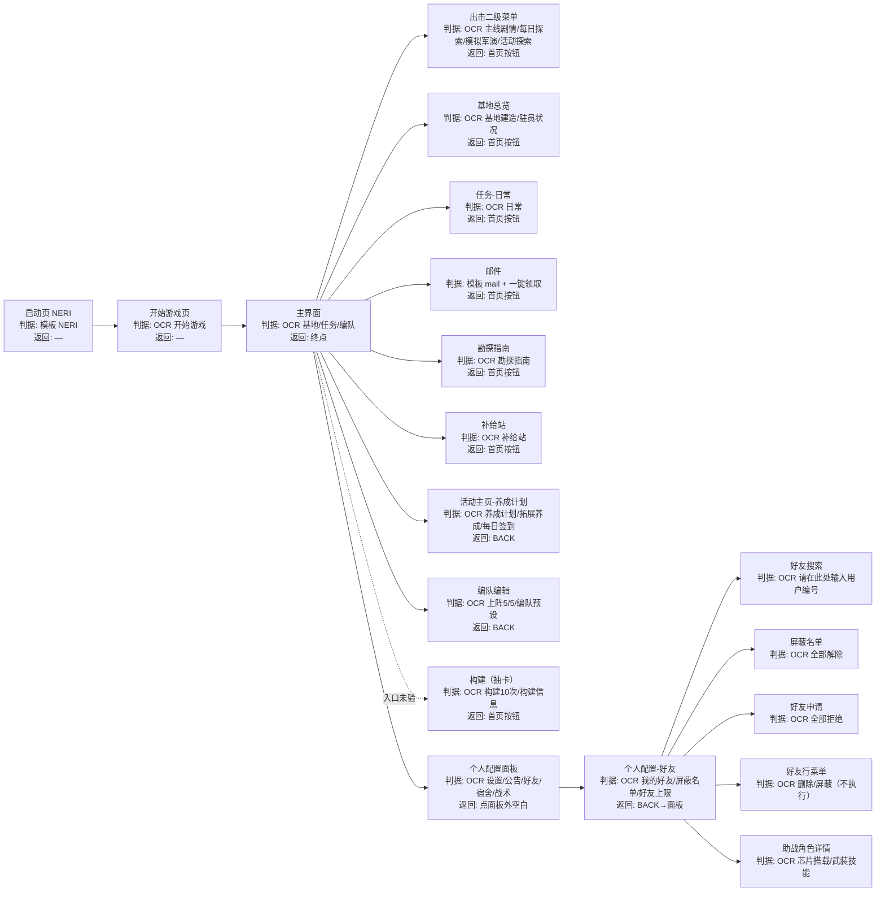
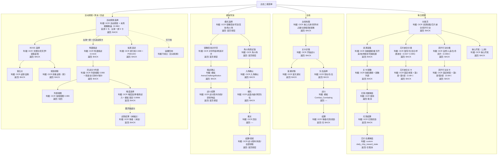
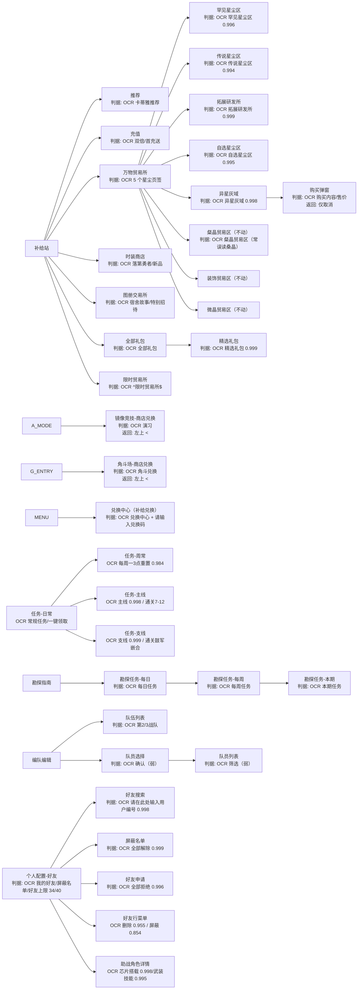
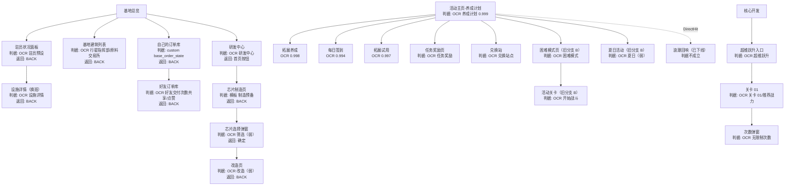

# 界面导航图（交错战线 · B服 3.3.1）

> 生成日期：2026-11-05。**已包含首轮只读实机补证**（12:20–12:42，MuMu 127.0.0.1:16416）：按 `导航覆盖度.md` 清单进入并实测判据/返回方式，全部留帧（`apps/crosscore-auto/sandbox/needframes`）与 OCR 日志（`apps/crosscore-auto/sandbox/logs/nav_probe_20261105_*.log`）。
> **第二批只读探索**（12:57–13:13）因设备被另一条线的 MAA「每日探索」任务周期性占用而中止，仅新增 3 个界面（见第 10 节）。
> **第二批续**（14:05–14:31）与**第三批**（14:36–14:55）、**第四批**（15:04–15:17）在干扰源清除后补证：共新增 16 个界面（第 11 节 5 个、第 12 节 6 个、第 13 节 5 个），详见第 11–13 节。
> **第五批**（15:45–16:04）为授权动作批：周本已领取态判定、公告「今天不再提示」实测、商品购买弹窗关闭、邮件单封领取（+2000 金币），详见第 14 节。
> 机器可读版本：[nav_graph.json](../assets/navigation/nav_graph.json)；覆盖面统计见 [导航覆盖度.md](导航覆盖度.md)。

## 0. 覆盖率结论

| 口径 | 数量 | 占比 | 说明 |
|---|---:|---:|---|
| 已实测（A） | 120 / 134 | 89.6% | 判据 + 入口 + 返回均有本机实跑证据 |
| 代码里有、未实跑（B） | 9 / 134 | 6.7% | 识别器/入口存在，未实跑或返回未验证 |
| 判据弱或入口缺失（C） | 2 / 134 | 1.5% | 浪潮回响（活动已下线）、历战结算（禁战斗） |
| 完全没有（缺失页） | 3 / 134 | 2.2% | 构建结果、好友资料、星贸凭证页签（均需授权或入口不存在） |

- **主线刚需链路**（启动 → 主界面 → 出击 → 主线/每日探索 → 战斗/结算，以及主界面 → 基地 → 基建面板、领取奖励、补给站礼包）**全链路 A**：约 25 个界面，连通率 **100%**。
- 全量口径「至少有一个识别器」= 131 / 134 = **97.8%**；「有实测证据」= **89.6%**。节点 131、边 134（第十一批 +5 节点 +5 边；建筑列表 B→A）。
- 仍缺的主要是：角斗场随机模式累计结算（「全部领取」）1、创生微粒次数弹窗 1、队员选择 1（满编 5/5 不可达）、活动旧分支 3（已被当期轮换）、构建抽卡页 1、芯片改造页 1（需授权）、构建结果 / 好友资料 / 星贸凭证页签。

## 1. 三档证据定义

| 档位 | 含义 | 判定规则 |
|---|---|---|
| **A 已实测** | 该界面在当前 1280×720 上真实到达过 | `docs/ondevice-checklist.md`、`docs/交接-四任务迁移实机验证.md`、`docs/主线.md`、`docs/基建.md`、`docs/arena.md` 等有对应实跑记录；识别判据来自现行 pipeline |
| **B 代码里有** | 能识别、能进入，但没实跑过 | pipeline 有 OCR/Template/Custom 节点与入口；docs 无该页实跑记录（或只有离线帧/旧录制） |
| **C 判据弱/入口缺失** | 目前不可靠导航 | 页面判据只是按钮文字（如「列表视图」）、全屏 OCR 无 ROI（如「好友」）、入口只有 DirectHit，或根本没有入口节点 |

> 旧录制图 `assets/navigation/page_graph.json`（46 个页面、坐标由 1920 缩放）**只作交叉参考**，其坐标一律不直接复用；本文件所有 ROI 均取自 pipeline 现值。

## 2. 总览：主界面是一级入口的唯一枢纽

## 3. 出击：五条主分支

## 4. 商店、任务、邮件、编队、好友

## 5. 基建、芯片、活动分支

## 6. 关键节点表（ROI 均为 1280×720）

| 界面 | 到达判据（OCR 关键词 / 模板 / Custom） | ROI | 入口动作 | 返回方式 | 证据 |
|---|---|---|---|---|---|
| 主界面 | OCR 基地/任务/编队 | [493,580,773,137] | 开始游戏后 首页标志1 | 终点（首页按钮） | A |
| 出击二级菜单 | OCR 主线剧情/每日探索/模拟军演/活动探索 | [350,40,850,620] | OCR 出击 | 首页按钮/BACK | A |
| 基地总览 | OCR 基地建造/驻员状况 | [30,430,350,250] | OCR 基地 [527,600,153,110] | 首页按钮 | A |
| 驻员状况 | OCR 驻员预设 | [900,80,340,580] | OCR 驻员状况 [54,554,176,89] | BACK | A |
| 任务-日常 | OCR 常规任务/一键领取/日剧情任务 | [20,150,180,300] | OCR 任务 [640,600,120,100] | BACK | A |
| 任务-周常 | OCR 每周一3点重置 + 通关任意关卡20次（0.984/0.997） | [650,185,560,110] | 左栏「周常」[63,324] | BACK | A |
| 任务-主线 | OCR 主线 0.998 + 通关7-12 | [20,200,280,260] | 左栏「主线」[68,362] | BACK | A |
| 任务-支线 | OCR 支线 0.999 + 通关鼓军嵌合 | [20,200,300,260] | 左栏「支线」[65,435] | BACK | A |
| 邮件 | 模板 mail.png / 一键领取 | [1025,15,120,50] | 点邮件图标 | 首页按钮 | A |
| 勘探指南 | OCR 勘探指南 | [20,20,360,180] | OCR 勘探指南 [0,80,160,80] | 首页按钮 | A |
| 补给站 | OCR 补给站 | [934,582,176,127] | OCR 补给站 [1008,593,111,118] | 首页按钮 | A |
| 补给站-推荐 | OCR 卡蒂雅推荐 0.996 | [80,260,300,400] | 左栏「推荐」[106,136] | BACK | A |
| 补给站-充值 | OCR 双倍/首充送（0.999） | [500,110,800,500] | 左栏「充值」[113,214] | BACK | A |
| 时装商店 | OCR 落第勇者 0.998 | [300,85,400,60] | 左栏「时装商店」[131,443] | BACK | A |
| 图册交易所 | OCR 宿舍故事 0.999 / 特别招待 0.997 | [300,85,450,80] | 左栏「图册交易所」[141,520] | BACK | A |
| 全部礼包 | OCR 全部礼包 | [180,40,420,180] | OCR 礼包 [20,325,203,81] | 首页按钮 | A |
| 精选礼包 | OCR 精选礼包 0.999 + 中级调频礼包 | [470,105,300,40] | 「精选礼包」页签 [548,130] | BACK | A |
| 万物贸易所 | OCR 5 页签 0.986~1.000 | [280,85,940,35] | 左栏「万物贸易所」[140,674] | BACK | A |
| 罕见星尘区 | OCR 罕见星尘区 0.996 + 构建蓝图 | [280,85,940,220] | 顶部页签 [347,105] | 切页签 | A |
| 传说星尘区 | OCR 传说星尘区 0.994 | [280,85,940,220] | 顶部页签 [546,105] | 切页签 | A |
| 拓展研发所 | OCR 拓展研发所 0.999 | [280,85,940,220] | 顶部页签 [744,105] | 切页签 | A |
| 自选星尘区 | OCR 自选星尘区 0.995 | [280,85,940,220] | 顶部页签 [944,105] | 切页签 | A |
| 异星灰域 | OCR 异星灰域 0.998 | [280,85,940,220] | 顶部页签 [1143,105] | 切页签 | A |
| 限时贸易所 | OCR 限时贸易所 0.998 | [300,85,900,220] | 左栏「限时贸易所」[141,596] | 切页签 | A |
| 主线地图 | OCR 核心元库/世界树之巅/主脉链路/困难 | [600,545,220,70] | OCR 虚拟场域 [1060,445,220,90] | BACK | A |
| 主线关卡详情 | OCR 开始战斗 | [1020,610,250,90] | 点区域名（0/x） | BACK | A |
| 队伍选择 | OCR 现在/队伍 | [180,120,900,480] | OCR 扫荡 [840,618,130,55] | BACK | A |
| 战斗 | 模板 Combat_Combating | [1169,27,105,59] | OCR 开始战斗 [920,525,210,62] | — | A |
| 主线结算 | OCR 扫荡（左上） | [5,2,530,155] | 战斗结束 | 仅 BACK | A |
| 扫荡结算（每日） | OCR 扫荡奖励 / 等级 | [569,5,181,66] / [210,481,97,82] | 扫荡弹窗→开始战斗 [943,521,159,85] | BACK | A |
| 每日探索分类 | OCR 资源采集/芯片嵌合/跃升行动 | [80,60,520,600] | OCR 每日探索 [820,230,310,230] | BACK | A |
| 资源采集 | OCR 技能磨砺/星币开采/技术解析/荒墟拾遗 | [760,50,480,600] | OCR 资源采集 [130,70,390,230] | BACK | A |
| 芯片嵌合分类 | OCR 鼓军/光/迅刃/矛盾嵌合（0.937~0.995） | [840,130,240,500] | 卡片「芯片嵌合」[362,396] | BACK | A |
| 芯片嵌合关卡 | OCR 固定掉落 + 第1层~第5层（0.99+） | [930,85,260,450] | 卡片「鼓军嵌合」[907,159] | BACK | A |
| 跃升行动分类 | OCR 自然/人造/生命跃升（0.996+） | [840,130,240,300] | 卡片「跃升行动」[361,561] | BACK | A |
| 跃升行动关卡 | OCR 固定掉落 + 第1层/第2层（0.99+） | [930,85,260,300] | 卡片「自然跃升」[910,159] | BACK | A |
| 芯片仓满弹窗 | custom daily_chip_reward_state | — | 结算后自动出现 | 仅取消 | A |
| 模拟军演模式 | OCR 镜像竞技/军演竞技/角斗场 | [380,90,700,440] | OCR 模拟军演 [200,310,240,110] | 首页按钮 | A |
| 镜像竞技对手 | OCR 对手阵容/刷新对手 | [413,73,800,80] | OCR 镜像竞技 [390,300,500,220] | 首页按钮 | A |
| 挑战确认 | 模板 ArenaChallengeButton.png | [740,600,200,90] | custom arena_state click_challenge | BACK | A |
| 活动探索选择 | OCR 活动探索 0.996 + 本周报酬微晶 | [500,70,400,160] | 出击→活动探索 [650,152] | BACK | A |
| 特遣挑战 | OCR 特遣挑战 0.919 | [380,390,260,110] | 左滑一屏→历战试炼卡 [848,494] | BACK | A |
| 历战关卡列表 | OCR 列表视图 0.998 + 奇美拉/尤弥尔/瑞尔 | [280,80,900,540] | 特遣挑战 [509,431] | BACK | A |
| 历战列表视图 | OCR 常规视图 0.999 | [280,80,900,540] | 「列表视图」[1110,600] | 切回 | A |
| 历战难度选择 | OCR 难度选择/推荐战力 + 模板 锁定 **0.9996** | [420,510,620,140] / [269,588,554,78] | BOSS 瑞尔 [1109,153] | BACK | A |
| 拟真演训 | OCR 排行榜 0.998 + PSEUDO 0.820 | [970,230,230,140] | 左滑一屏→拟真演训卡 | BACK | A |
| 周本 BOSS 页 | OCR 戈里刻/尼克罗/诺斯虚影 | [30,170,760,500] | OCR 碎星虚影 [20,443,860,100] | BACK | A |
| 活动主页-养成计划 | OCR 养成计划 0.999 / 拓展养成 0.998 / 每日签到 0.994 | [20,65,900,600] | 主界面「活动」[1210,157] | BACK | A |
| 研发中心 | OCR 研发中心 / 模板 收菜按钮 | — | OCR 研发中心 | 首页按钮 | A |
| 芯片制造 | 模板 制造预备.png | — | 点击新增 | BACK | A |
| 编队编辑 | OCR 上阵5/5 + 编队预设 0.996 | [20,80,400,560] | 主界面「编队」[801,678] | BACK | A |
| 个人配置面板 | OCR 设置 0.999 / 公告 1.000 | [820,250,440,320] | 菜单多 0.9456 → [1222,44] | 点面板外空白 | A |
| 个人配置-好友 | OCR 我的好友 0.993 / 屏蔽名单 0.996 / 好友上限 0.986 | [110,640,1060,55] | 面板「好友」[886,372] | BACK→面板 | A |
| 好友搜索 | OCR 请在此处输入用户编号 0.998 | [560,100,400,60] | 底部「搜索」[359,672] | 切页签 | A |
| 屏蔽名单 | OCR 全部解除 0.999 | [1050,35,200,60] | 底部「屏蔽名单」[733,672] | 切页签 | A |
| 好友申请 | OCR 全部拒绝 0.996 | [1050,35,200,60] | 底部「申请」[547,672] | 切页签 | A |
| 好友行菜单 | OCR 删除 0.955 / 屏蔽 0.854 | [960,110,120,110] | 好友行「…」[1159,169] | BACK | A |
| 助战角色详情 | OCR 芯片搭载 0.998 / 武装技能 0.995 | [880,240,340,430] | 助战头像 [927,135] | BACK | A |
| 角斗场测试版 | OCR 角斗场 | [404,233,472,262] | OCR 角斗场 [152,263,247,183] | 首页按钮 | B |
| 周本领奖页 | OCR 碎星虚影 | [20,445,265,95] | 点碎星虚影卡片 | BACK | B |
| 浪潮回响 | **判据不成立**：活动轮换，8 卡内无入口；模板 0.25 | — | 入口不存在 | — | C |
| 历战结算 | **未触达**：需「开始战斗」，本轮禁战斗/禁消耗 | — | — | — | C |

> 完整 98 个节点的判据、入口、父节点与返回路径见 [nav_graph.json](../assets/navigation/nav_graph.json)。

## 7. 返回路径统一口径（含本轮实测差异）

| 路径 | 实现 | 适用 | 本轮实测 |
|---|---|---|---|
| 左上首页按钮 | `子任务_点击首页按钮`（模板 HomeButton/HomeButton1） | 任意子页回主界面（首选） | 未单测（沿用旧证据） |
| 左上 BACK | `子任务_点击返回`（模板 BackButton） | 逐级返回；主线首通结算只允许 BACK | 好友/搜索/任务/编队/活动/商店/历战链均有效 |
| 页面「返回主页」 | `通用-返回主页`（模板 返回主页.png） | 活动/周本二级页 | 未单测 |
| 底部页签切换 | 好友页 4 页签、礼包 5 子页签、贸易所 5 页签 | 同级页切换 | 有效 |
| 点面板外空白 | 个人配置面板 `(500,400)` | 关闭右侧抽屉 | 有效；**BACK 对该面板无效** |
| 视图切换按钮 | 历战「列表视图/常规视图」同点 [1110,600] | 列表↔网格 | 双向有效 |
| 首页标志复核 | OCR 基地/任务/编队 | 每次回主界面后确认 | 主界面 3 帧均命中 |
| 弹窗关闭链 | JumpBack：获得物品/取消/确认/同意/公告/促销 | 任意时刻弹窗 | 本轮未触发 |

## 8. 已知局限

1. **只读边界**：本轮进入 24 个界面但未开始行动/战斗、未购买/抽卡/领取、未点删除/屏蔽/全部解除/全部拒绝；因此「历战结算」仍未触达，角斗场/芯片改造仍为 B。
2. **坐标来源**：本轮 ROI/点击点均为 1280×720 实机 OCR（box + score 落在 `sandbox/logs`），未做缩放；旧录制图坐标仍不直接复用。
3. **C 档不等于界面不存在**：浪潮回响为活动轮换下线（入口确实不存在）；历战结算是被禁战斗挡住，不是判据错。
4. **付费/消耗闸门**：异星灰域、限时贸易、充值、时装、图册交易所、角斗场、芯片改造、抽卡入口只做导航记录，复用时必须先走 fail-closed 闸门。
5. **活动版本差异**：当期活动为「养成计划」，旧图里的「夏日/浪潮回响/困难模式」判据已不适用；活动卡每期轮换，复用前按 `weekly_select` 的 8 卡现判据重新确认。
6. 屏幕空闲会进入**游戏自己的屏保**（20 秒级；前台仍是游戏、keyguard=false），批处理前轻点中性点 `(1200,400)` 或按一次 BACK 唤醒，并**下一帧复核**已离开待机画面；`KEYCODE_WAKEUP` + 上滑只用于真正的系统锁屏（P-051 / `docs/项目规范.md` §8.1）。

## 9. 本轮只读实机补证明细（2026-11-05 12:20–12:42）

### 9.1 C 档 11 项结果

| # | 界面 | 结果 | 实测判据（OCR/模板） | box / ROI | 返回方式 | 证据帧（`sandbox/needframes`） |
|---|---|---|---|---|---|---|
| 1 | 好友页 | A | 我的好友 0.993 / 屏蔽名单 0.996 / 好友上限 0.986 | [125,659,93,27] 等，ROI [110,640,1060,55] | BACK→个人配置面板 | `friend_page_post_20261105_122236_23412.png` |
| 2 | 好友搜索 | A | 请在此处输入用户编号 0.998 | [632,116,173,24]，ROI [560,100,400,60] | 底部「我的好友」切回 | `friend_search_post_20261105_122302_21300.png` |
| 3 | 屏蔽名单 | A | 全部解除 0.999 | [1080,51,93,29] | 底部页签切回 | `friend_blacklist_post_20261105_122320_6292.png` |
| 4 | 精选礼包 | A | 精选礼包 0.999 + 中级调频礼包 | [502,116,91,28] | BACK / 子页签 | `shop_featured_post_20261105_122745_24076.png` |
| 5 | 罕见星尘区 | A | 罕见星尘区 0.996 + 构建蓝图 | 顶部页签 [280,85,940,35] | 切页签 / BACK | `trade_home_post_20261105_122801_12328.png` |
| 6 | 芯片嵌合关卡 | A | 固定掉落 0.997 + 第1层 0.993 + 第5层 0.999 | [949,99,75,26] 等 | BACK→嵌合分类 | `chip_fusion_gujun_post_20261105_123231_20628.png` |
| 7 | 跃升行动关卡 | A | 固定掉落 0.998 + 第1层 0.989 + 第2层 0.997 | [949,99,75,26] 等 | BACK→跃升分类 | `ascension_nature_post_20261105_123309_11888.png` |
| 8 | 历战关卡列表 | A | 列表视图 0.998 + 奇美拉/尤弥尔/瑞尔 | [1064,586,93,28] | BACK→特遣挑战 | `trial_list_post_20261105_123717_6748.png` |
| 9 | 历战难度选择 | A | 难度选择/推荐战力 + 模板锁定 **0.9837/0.9996** | ROI [269,588,554,78] | BACK→关卡列表 | `trial_lock_tpl_20261105_123808_24196.png`、`trial_ruier_post_20261105_123749_12328.png` |
| 10 | 浪潮回响 | **判据不成立** | 活动探索 8 卡均无该入口；模板 0.25 | — | — | `event_explore_post_20261105_123604_23304.png`、`sw_left1_post_20261105_123628_21592.png` |
| 11 | 历战结算 | **未触达** | 需点「开始战斗」，本轮禁战斗/禁消耗 | — | — | `trial_ruier_post_20261105_123749_12328.png`（只到难度选择） |

### 9.2 顺手转 A 的 B 档（9 个）

任务-周常/主线/支线、万物贸易所、异星灰域、限时贸易所、芯片嵌合分类、跃升行动分类、编队编辑。

### 9.3 新发现并登记为 `discovered_by_explore` 的界面（15 个）

个人配置面板、好友申请、好友行菜单、助战角色详情、补给站-推荐/充值/时装商店/图册交易所、传说星尘区、拓展研发所、自选星尘区、活动主页-养成计划、拟真演训、特遣挑战、历战列表视图。

- 入口线索：个人配置面板=主界面右上「…」（模板 菜单多 0.9456）；助战角色详情=好友行助战头像；活动页=主界面右上「活动」；活动卡=出击→活动探索，先左滑一屏；历战链=历战试炼卡→特遣挑战→关卡。
- 未执行的高风险控件：删除/屏蔽/全部解除/全部拒绝、开始挑战/开始战斗、任何购买/充值/抽卡/领取。

### 9.4 判据不成立 / 未触达的具体原因

- **浪潮回响**：当期活动已轮换为「养成计划」；`活动探索` 首屏 4 卡（碎星虚影/深渊禁区/永境战域/迷之金字塔）+ 左滑一屏 4 卡（拟真演训/历战试炼/末日战线/实战预演），OCR 全帧无「浪潮回响」；旧模板 `浪潮回响.png` 实测 **0.25**。结论：入口不存在，保留 C 仅作历史。
- **历战结算**：瑞尔详情页仅到「难度选择」；继续必须点「开始战斗」，本轮硬边界禁止战斗/消耗，燃料与次数未动；判据「OCR 等级」仍未验证。需单独授权。

## 10. 第二批只读探索（2026-11-05 12:57–13:13）——设备被并发占用，提前中止

### 10.1 P 级问题：另一条线的 MAA 任务在周期性接管设备

- 现象：主界面 / 每日探索分类页 / 资源采集「关卡04」/ 扫荡弹窗之间每 10–60 s 自动跳转，而我方两次 `getevent` 监测（18 s、45 s）**没有捕获任何输入事件**。
- 证据：`.tmp/daily-explore/` 每约 3 分钟生成一份运行目录（12:44…13:10），`maa-log/maafw.log` 记录任务 `出击任务列表` 在节点 `每日探索_扫荡弹窗已打开` 的 `每日探索_按体力计算次数` 动作失败（`success:false`），随后任务 `Tasker.Task.Failed`；该任务不会走到结算，但每次都会把设备带到「关卡04 + 扫荡弹窗」。
- 影响：设备并非空闲；探索随时可能被第三方点击打断。**本次未消耗燃料**：右上体力 241→242（仅自然回复），未出现战斗页/结算页，未点任何「开始战斗」。
- 处置：尝试 `Stop-Process` / `taskkill` 停止 4 个残留 `run_daily_explore.py`，两者均返回「不存在」（句柄已僵死）；13:15 后对方仍在清理运行目录，说明控制源不在这些僵尸进程里。**需用户确认暂停另一条线后再继续本批。**

### 10.2 本批新增并登记 `discovered_by_explore`（3 个）

| 界面 | 判据读数 | box / ROI | 返回方式 | 入口 | 证据帧 |
|---|---|---|---|---|---|
| 个人档案页（异态专家） | 异态专家 0.939 / 游戏进度 0.998 / 徽章展示 0.986 / 支援助战 0.995 | [68,275,90,24]、[77,443,96,28]；ROI [60,140,240,420] | 左上「<」(84,46) → 主界面（实测） | **未确认**：在资源采集关卡页点左上「<」后落到本页，需复核该按钮语义 | `back_to_daily_list_post_20261105_130710_1472.png` |
| 满馈赠礼（限时礼包促销弹窗） | 满馈赠礼 0.995 / 今天不再提示 0.996 | 标题 [165,117,91,28]；底部 [1108,632,102,23] | 右上 X (1210,135) 关闭 → 主界面（实测） | 主界面右侧「满馈赠礼」促销条 0.993，click (1209,256) | `enter_daily_resource_post_20261105_130349_23456.png`、`close_feed_shop_popup_post_20261105_130417_20788.png` |
| 确认退出弹窗 | 确认退出？ 0.941 / 取消 1.000 | [588,289,94,24] / [532,390,49,30] | 点「取消」(556,405) 关闭并停留原页（两次复现） | 每日探索分类/关卡页按 **BACK** 触发 | `state_20261105_130011_20840.png`、`cancel_exit3_post_20261105_131118_3796.png` |

### 10.3 本批修正的实测口径

- **BACK 在每日探索链路上不是返回**：会弹「确认退出？」，只能点「取消」；逐级返回请用左上「<」(84,46) 或左上首页按钮。
- **扫荡次数弹窗的关闭方式**：点弹窗外空白 **(140,450)** 可关闭（12:57、13:10 两次实测）；切勿点弹窗内「开始战斗」(1013,560) 或页面「开始战斗」(1175,621)。
- 资源采集「关卡04」详情页判据：固定掉落 0.997 [392,101,74,23] / 技能磨砺 0.994 [840,144,112,32] / 第4层 0.998 [598,453,63,30] / 无限制次数 0.998 [900,501,93,23] / 扫荡 1.000 (898,621)；返回用左上「<」。
- 出击二级菜单是可上下分页的整页轮播（活动探索 / 每日探索 / 模拟军演 / 主线剧情），底部左右箭头 (69,675)/(1203,675) 可切页；**整页纵向 swipe 会直接换分区**，不适合在分区内做细滚。

### 10.4 本批未完成（被占用中止，全部仍待补）

创生微粒 4（核心开发 / 超维跃升入口 / 关卡01 / 次数弹窗）、订单库 2（自己 / 好友）、队员选择 / 队员列表、活动 8 卡剩余 5 页、个人配置子页（档案 / 教程 / 宿舍 / 战术 / 设置 / 公告）、D 档可只读 6 项（仓库 / 图鉴 / 设置账号 / 星贸凭证·新途补给 / 邮件详情 / 好友资料）。

## 11. 第二批续（2026-11-05 14:05–14:31）：干扰源清除后的只读补证

设备已解锁（KEYEVENT 224 + 上滑，无密码），开工前实测：主界面、无弹窗、体力 245/240。

### 11.1 新增并登记（5 个，均 A、均 `discovered_by_explore`）

| 界面 | 判据读数 | 返回方式 | 入口 |
|---|---|---|---|
| 仓库（物品/芯片） | 物品 1.000 / 芯片 1.000 / 稀有度 0.999 / 筛选 0.999 / 普通物品 0.997 | 左上「<」(84,46) → 主界面 | 主界面顶部右侧第三个图标 (1154,46) |
| 邮件详情（列表右侧分栏） | 核心管理员 0.997 / 领取 0.996；切换邮件日期 2026/11/5→2026/11/4 | 无独立返回，点另一封即切换；离开用「<」 | 邮件页点选邮件行 (199,264) |
| 星贸凭证（折扣礼包购买弹窗） | 星贸凭证 0.997 / 点击购买 0.997 | 右上 X (1111,143) → 主界面 | 主界面「星贸凭证」条 (1103,157) |
| 是否退出基地？确认弹窗 | 是否退出基地？0.991 / 取消 0.998 / 确定 0.999 | 取消(477,449) 停留；确定(802,448) 回主界面（仅导航） | 基地总览左上「<」(84,46) |
| 支援助战-入手顺序弹窗 | 入手顺序 1.000 / 取消 0.998 | 取消(931,658) → 个人档案页 | 个人档案页右下扳手 (1169,569) |

### 11.2 既有节点转 A / 入口实测

| 界面 | 判据读数 | 入口 | 返回 |
|---|---|---|---|
| 队员列表 `member_list` | 编队 1.000 / 筛选 0.999 / 波塞冬 0.998 | 底部「队员」(888,677) | 「<」(84,46) → 主界面 |
| 邮件页 `mail` | 待领取邮件 0.992 / 未读邮件 0.997 / 助战奖励 0.985 / 资源溢出邮件 0.998 / 39/200 | 主界面信封图标 (1065,46) | 「<」(84,46) → 主界面 |
| 基地总览 `base_overview` | 行星指挥部 0.998 / 合成工厂 0.995 / 能源发电站 0.998 / 研发中心 0.999 / 原料交易所 0.999 / 挖掘矿场 0.985 | 底部「基地」(625,678) | 「<」(84,46) → 退出基地确认 |
| 设施详情 `base_build_detail`（原料交易所/研发中心/行星指挥部同构） | 原料交易所 0.999 / 研发中心 0.999 / 行星指挥部 0.998 + 满载负荷 0.997 / 设施列表 / 信息 / 角色管理 | 基地总览点建筑 (1041,337)/(592,294)/(775,120) | 「<」(84,46) → 基地总览 |
| 编队编辑 `team_edit` | 编队预设 0.996 / 清空队伍 0.995 / 琶音 1.000 / 平面 0.996 | 底部「编队」(800,678) | 「<」(84,46) → 主界面 |
| 个人档案页 `profile_archive` | 异态专家 0.939 / 游戏进度 0.998 / 徽章展示 0.986 / 支援助战 0.995 | **已确认**：主界面左上头像 (60,56) | 「<」(84,46) → 主界面 |
| 个人配置面板 `profile_panel` | 设置 0.997 / 好友 0.996 / 宿舍 0.998 / 公告 0.998 / 成就 0.995 | 主界面右上小图标 (1217,37) | 点面板外空白 |
| 好友列表 `friend_action_menu`（我的好友） | 我的好友 0.997 / 好友上限34/40 0.986 / 屏蔽名单 0.996 / 搜索 0.999 / 申请 0.996 | 配置面板「好友」(886,372) | 「<」(84,46) → 主界面 |
| 好友搜索 `friend_search` | 搜索 0.999 / +添加 0.901 / 推荐好友列表 | 好友页「搜索」tab (359,672) | 切回「我的好友」tab |

### 11.3 判据不成立 / 未触达（本批）

- **核心开发（创生微粒）**：每日探索页只露出 资源采集 / 芯片嵌合 / 跃升行动 三张分类卡；左栏纵向 swipe（2 次）与底部翻页箭头点击（1 次）均无位移，`核心开发` 判据未出现。原因：该页分类区不支持滚动，入口应在别处（未定位）。**3 次尝试后停手。**
- **订单库（自己/好友）**：基地→原料交易所 / 研发中心 / 行星指挥部 三个设施详情均为「设施列表 / 信息 / 角色管理」结构，无订单入口；基地总览与任务页也无订单按钮。入口未找到，保持 B。
- **好友资料**：好友行（行体、头像、名字、右下「…」、房子图标）各点 1 次均无跳转；该页行内无资料入口，保持 B。
- **队员选择**：编队编辑页右侧已直接展开队员名录（等级/筛选/战力 51035）；点空位 (537,176) 无反应，选择动作会改阵容，未执行，保持 B。
- **设置·账号**：配置面板「设置」(1207,371) 本轮未进入（时间让给其他项），保持 D。

### 11.4 需授权（本批新增确认 / 未点）

1. 星贸凭证「点击购买」(794,584) — 折扣礼包，确认即扣货币/凭证。
2. 邮件「领取」(1139,632) / 「一键领取」/ 「删除已读」 — 领取或删除改变资源/邮件账。
3. 支援助战「确定」 — 会改动助战阵容（本批只点取消）。
4. 给好友行「…」菜单 — 含删除/屏蔽，属不可逆，未展开。

## 12. 第三批只读补证（2026-11-05 14:36–14:55，约 19 分钟）

设备已解锁（`KEYEVENT 224` 唤醒后无密码、直接回主界面），开工前实测：主界面、**有「确认退出？」弹窗**（点「取消」(556,405) 关闭）、体力 **246/240**、金币 1310178。收工时已回主界面、无弹窗，体力 247/240（自然回复，未消耗）。

### 12.1 新增并登记（6 个，均 A、均 `discovered_by_explore`）

| 界面（节点 id） | 判据读数（OCR） | box / ROI | 返回方式（实测） | 入口 |
|---|---|---|---|---|
| 档案/成就收集页（`achievement_overview`） | 总完成度 0.998 / 416/496 1.000 / 概况 0.999 / 成就收集 0.999 / 完成进度 0.998 / 筛选 0.998 | 总完成度 [581,108,88,28]；416/496 [1145,111,83,24]；ROI [0,80,1280,620] | BACK → 个人配置面板（无确认弹窗） | 面板第 1 行第 2 个按钮 (994,275) |
| 档案/图鉴总览页（`archive_gallery`） | 角色 1.000 / 敌人 0.999 / 皮肤 0.999 / 故事集 0.999 / 279-279 0.990 / 134-134 0.919 / 628-628 0.995 | 角色 [444,266,37,19]；敌人 [745,189,37,21]；ROI [0,80,1280,600] | BACK → 面板；左上「<」(85,46)、home(201,46) | 面板第 1 行第 3 个按钮 (1069,278) |
| 宿舍（`dormitory`） | 宿舍 0.998 / 恢复速度191% 1.000 / 宿舍列表 1.000 / 设施列表 0.999 / 42-45 1.000 / 5-5 0.999 / 3828 0.999 | 宿舍 [65,97,39,22]；恢复速度 [1041,67,133,23]；ROI 全屏 | BACK →「提示/是否退出宿舍？」→「确定」(802,448) → 主界面（3-5 s 过场）；「取消」(477,449) 留原地 | 面板第 2 行第 2 个按钮「宿舍」(993,372) |
| 战术页（`tactics`） | 战术重置 0.994 / 经验加成1 0.997 / 伤害增幅1 0.997 / 作战整备1 0.997 / 机动战术 0.998 / 星币加成1 0.996 | 战术重置 [1090,37,94,27]；点数 140 [981,42,32,20] | BACK → 面板 | 面板第 2 行第 3 个按钮「战术」(1100,369) |
| 设置页（`settings`） | 画面设置 0.993 / 音频设置 0.999 / 战斗设置 0.992 / 其他设置 0.999 / 用户中心 0.999 / 3.3.1_13_0_600 0.964 | 画面设置 [53,161,105,24]；用户中心 [60,657,78,25] | BACK → 面板 | 面板第 2 行第 4 个按钮「设置」(1206,371) |
| 公告页（`announce`） | 系统公告 0.997 / 活动消息 0.998 / 公告 0.930 / 今天不再提示 0.998 | 系统公告 [562,88,76,24]；活动消息 [394,90,75,22] | BACK → 面板（从面板进入时）；模态态点 X(1209,92) | 面板第 3 行「公告」(885,458)；**登录后自动弹窗** |

- 设置页内含图像质量三档：高(1080,396) / 中(757,397) / 低(434,397)；底部「用户中心」(99,669)、版本号 `3.3.1_13_0_600` 可作版本判据（未进入用户中心）。
- 档案页内：左栏页签 概况/成长/主线/战斗/挑战/经历；点「主线成就」(71,436) 进成就详情网格，详情页左上「<」(85,46) 回概况；底部「一键领取」(111,688) 属领取，未点。

### 12.2 本次新修正的返回口径（重要）

| 场景 | 现象（实测） | 正确做法 |
|---|---|---|
| 个人配置面板（右侧抽屉） | BACK **不关闭面板**；**连按第二次 BACK 会直接退出游戏到 B 站「游戏中心」**（帧 `relaunch_probe` 系列已记录，需重新点「交错战线」冷启动） | 关闭面板用点面板外空白 (500,400)；**不要用 BACK** |
| 宿舍场景 | BACK 弹「提示 / 是否退出宿舍？」，不是直接返回 | 点「确定」(802,448) 退场景 → 主界面；或「取消」(477,449) 留原地 |
| 档案/图鉴/设置/战术/公告（面板子页） | BACK 直接回面板，无二次确认 | BACK 可用 |
| 每日探索链路 | BACK 弹「确认退出？」（已记于 11.3） | 逐级返回用左上「<」(84,46) |

### 12.3 判据不成立 / 未触达（本批）

- **队员选择**：底部「队员」→ 队员列表（筛选 0.996 / 编队 1.000 / 波塞冬 0.998）正常；但本批未进编队编辑点空位，队员选择动作仍未验证，保持 B。
- **创生微粒 4 / 订单库 2 / 活动 8 卡剩余 5 页 / 好友资料**：未在本批时间窗内重试（沿用第 11.3 节结论：核心开发入口未定位、订单库无入口、好友行点击无跳转）。创生微粒 4、订单库 2 保持 B；好友资料仍列为缺失页（D）。
- **设置页「用户中心」「补给兑换」**：未进入，保持未验证（不影响设置页判据成立）。

### 12.4 需授权（本批只登记，未点）

1. 档案页「一键领取」(111,688) — 领取会结算成就奖励。
2. 战术页「战术重置」(1090,37) — 会重置战术加点/资源分配。
3. 宿舍「赠送」(903,684) /「商店」(999,685) — 送礼消耗道具、商店购买扣货币。
4. 公告正文「点击跳转」(407,578) — 跳外部淘宝链接，非游戏内导航。

## 13. 第四批只读补证（2026-11-05 15:04–15:17，约 13 分钟）

### 13.1 创生微粒链路（2 个 B 转 A + 1 个 B → A，入口已彻底定位）

入口不在基地/商店/主界面图标，而在**每日探索分类页**：`swipe (495,240)→(520,160)` 后「核心开发」才出现（box=[272,559,160,37]，0.998，点 (352,577)）。

| 节点 | 判据读数（OCR） | box / ROI | 结论 |
|---|---|---|---|
| `altar_cat` 核心开发（分类页下滑后） | 核心开发 0.998 | [272,559,160,37] @分类页 | **B → A** |
| `daily_core_dev` 核心开发页（新增） | 超维跃升 0.992 / 可获得角色超维跃升 0.976 | 超维跃升 [853,142,112,34] | 新增，记 **B**（返回未单独实测） |
| `altar_entry` 超维跃升入口页 | 超维跃升 0.992 / 固定掉落 0.987 | ROI [800,90,410,180] | **B → A**（点 (909,159) 进关卡页） |
| `altar_stage` 超维跃升-关卡01 | 关卡01 0.975 / 推荐战力38000 0.990 / 关卡目标 0.991 / 通关条件 0.996 / 掉落物品 0.999 / 次数 0.999 | 关卡01 [1186,84,60,20] | **B → A** |
| `altar_count_modal` 次数弹窗 | 无 | — | **仍 B**：点「扫荡」(899,621) 一次未弹次数窗，直接退回分类页（疑因无通关阵容/券），按规则不硬试 |

- 关卡页底部同时有「扫荡」(899,621) 与「开始战斗」(1175,622)，均未点；页面标注「入场券-1」「门票刷新：每周一凌晨3点」。

### 13.2 订单库（2 个 B → A，自己/好友同页）

路径：主界面「基地」(627,677) → 基地总览 → 点**原料交易所建筑图标 (1128,326)**（不是文字 1029,387；点文字会进设施详情，这正是上一批失败原因）。

| 节点 | 判据读数 | box |
|---|---|---|
| `order_own` 自己的订单库（制作素材区） | 制作素材 0.997 / 10级订单库 0.989 / 11-11 0.961 / 刷新剩余时间 0.970 | 制作素材 [40,104,106,23] |
| `order_friend` 好友订单库（好友交付记录区） | 好友交付记录 0.997 / 选择好友 0.995 | 好友交付记录 [70,521,116,23] |

- 同一页面上下两区；4 个「交付」按钮与「选择好友」均未点（交付消耗素材，标**需授权**）。返回 BACK → 基地总览（实测）。

#### 13.2.1 好友路径（并列备选，不推荐）

| 路径 | 点击序列 | 点击数 |
|---|---|---|
| **原料交易所（推荐，唯一维护）** | 主界面「基地」(627,677) → 基地总览点原料交易所建筑图标 (1128,326) → 订单库 | 2 |
| 好友（备选） | 主界面右上角方框图标 (1144,40) → 好友列表行尾「…」(1175,170) → 菜单「交易订单」(919,194) → 订单库 | 3 |

- 两条路最终都到「订单库」布局；好友路径多一次点击，且依赖好友列表行与会话状态，**推荐只维护原料交易所路径**，好友路径仅作人工兜底。
- 「好友交付记录」位于**自己订单库左栏**（box `[78,521,116,23]`），与「制作素材」同列；模板 `image/好友交付记录.png`（116×62，2026-11-07 重裁），pipeline 节点 `基建_拜访好友`（roi `[60,470,180,110]`，`target_offset [21,133,0,0]`）。

### 13.3 新增（3 个 A + 1 个 B）

| 界面 | 判据读数 | 入口 | 返回 |
|---|---|---|---|
| 迷之金字塔活动页（`event_pyramid`） | 开启中 1.000 / 剩余时间 0.975 / 迷之金字塔 0.991 / 伤害 0.991 / 奖励预览 0.990 / 次数0-3 0.993 | 活动探索选择页点大卡 (602,221) | 「<」(85,46) → 选择页（实测） |
| 永境战域活动页（`event_world`） | 第27层 0.998 / 27层 0.996 / 掉落物品 0.999 / 排行榜 0.997 / 燃料0 0.997 | 选择页点「永境战域」（位置随轮播漂移，需 OCR） | 「<」(85,46) → 选择页（实测） |
| 账号管理弹窗（`account_modal`） | 账号管理 1.000 / 切换账号 1.000 / 实名信息 1.000 / 已实名 0.999 / 账号注销 1.000 | 设置页「用户中心」(99,669) | X(891,200) → 设置页（实测） |
| 兑换中心弹窗（`redeem_modal`） | 兑换中心 0.996 / 请输入兑换码 0.989 | 设置页「补给兑换」(93,547) | BACK（未单独截帧）→ 记 **B** |

### 13.4 判据不成立 / 入口不存在（本批结论）

- **好友资料页：入口不存在**。好友页可读（我的好友 0.993、好友上限 34/40 1.000）；单击行/头像/名字/「…」/房子图标共 5 次 + 长按 900 ms 1 次，全部无跳转（帧 `friend_longpress.png`）。仅剩「…」（删除/屏蔽类）与房子（拜访）入口，判定游戏无独立好友资料页，列为缺失页并注明原因。
- **队员选择：仍不可达**。编队页 上阵 5/5 无空位；点角色卡进的是「角色详情」（伊根·灭刃 / 芯片搭载 / 武装技能 / 战力9278），不是队员层。保持 B。
- **活动 8 卡剩余 3 页**（冥世试炼 / 拟真演训 / 闽限禁区等）：卡片位置随轮播漂移，连点 2 次都落回同一大卡，按「判据最多 2 次」停手。
- **周本领奖页**（`weekly_reward`）：本批只到活动探索选择页与两个活动内页，未进奖励领取页，保持 B。

### 13.5 需授权 / 非主动弹窗（如实记录）

1. 订单库 4 个「交付」+「选择好友」— 交付消耗制作素材，未点。
2. 迷之金字塔「开始战斗」(1154,641)、「禁区商店」(162,670) — 未点。
3. 永境战域「开始战斗」(1165,649)，页面显示「燃料0」— 未点。
4. 账号管理「切换账号」「账号注销」— 未点。
5. **非主动弹窗**：进入「活动探索」后，系统弹出「获得物品 600 微晶（点击空白处继续）」。这是本周报酬的系统结算提示（页面显示 本周报酬微晶 0/600），不是我点了领取；已按弹窗规则点空白 (200,300) 关闭，未再触发结算。

### 13.6 新增返回口径

- **出击二级菜单**点「<」(85,46) 回主界面会弹「确认退出？」（取消 556,405）——与每日探索链路 BACK 弹窗同源，别当普通返回。
- 活动内页「<」(85,46) → 活动探索选择页，无确认。
- 设置页子弹窗（账号管理 X 891,200 / 兑换中心 BACK）关闭后回设置页。

### 13.7 顺带记录（宿舍恢复速度）

宿舍页右上「恢复速度 191%」[1041,67,133,23] 1.000 为当前加成读数；本批未找到可读的加成来源面板（「布置」属家具操作，未点）。若要建模换班节奏，需另开一轮只读看「设施列表—宿舍」的加成明细。

## 14. 第五批：授权动作与弹窗实测（15:45–16:04，约 19 分钟）

> 本批为**授权动作批**：周本只读判定（未领）、公告勾选实测、购买弹窗只关闭、邮件领取一次。
> 帧：`apps/crosscore-auto/sandbox/needframes/state_20261105_154515_19164.png`（周本）、`open_announce_post_*` / `announce2_post_*`（公告）、`shop_pack_open_post_20261105_155812_3312.png`（购买弹窗）、`mail_claim_one_post_*`（邮件）。

### 14.1 周本（碎星虚影）·已领取态判据 → A

| 项 | 读数 | box | 置信度 |
|---|---|---|---|
| 本周报酬微晶 | 有 | [106,607,75,19] | 0.916 |
| 报酬进度 | **600/600** | [104,624,108,32] | 0.975 |
| 周刷新倒计时 | 「3天11:14:44后重置」 | [64,668,148,18] | 0.937 |
| 快速领取提示 | 完成全部任务后可解锁每周报酬快速领取 | [901,669,343,19] | 0.977 |
| 三个 BOSS | 戈里刻/诺斯/尼克罗虚影 | [161,430] / [558,430] / [914,432] | 0.981 / 0.989 / 0.983 |

- **本周报酬已满 600/600，判为已领取，未点领取**（符合「已领就不点」）。
- 未领取态（0/600）以 `docs/交接-周本碎星虚影领奖流程.md` 为准；已领取态另有一条旁证：碎星虚影卡不再停在最左槽。
- 周刷新唯一时间锚 = 上述倒计时文本，可直接做「到点才跑」门禁，不用固定周期猜。
- 返回：左上「<」(85,46) → 活动探索选择页；BACK 会弹「确认退出？」。

### 14.2 公告页「今天不再提示」

- 勾选框 box=[1059,609,24,25]，中心 **(1070,621)**；文字 box=[1093,616,121,23]，中心 (1153,627)，置信度 0.998。
- 实测 3 次点击（1069,622 / 1070,620 / 1153,627）：**勾选框外观无变化，未见勾选态**；第一次点击后公告页直接关闭并露出补给站，机制待复核。
- 关闭方式：从面板进入的公告页用左上「·公告」(86,96)；登录模态用右上 X(1209,92)。**「点击跳转」未点**（站外链接，永久禁止）。
- 满馈赠礼弹窗的「今天不再提示」[1108,632,102,23]：本批**未实测点击**，待下一批验证。

### 14.3 商品购买弹窗（只关闭，不购买）→ A

- 入口：补给站礼包卡 (439,386) → 弹窗「每日免费礼包」，售价显示「免费」。
- 关闭：右上 X **(1026,145)**，实测回到上一页；「购买」按钮 (880,536) **未点**。
- 弹窗内**未发现「不再弹出」勾选项**（购买按钮左侧的 √ 是货币图标，不是复选框）。

### 14.4 邮件领取（单封实跑）

| 项 | 领前 | 领后 |
|---|---|---|
| 顶部「待领取邮件」 | 非 0（详情页为「助战奖励」） | **0** |
| 金币（顶部读数） | 1310178 | **1312178（+2000）** |
| 右侧按钮 | 「领取」(1139,632) | 「删除」 |
| 底部奖励条 | 「2000」 | 「2000」+ **「已领取」[488,624,54,19] 0.992** |

- 领取同时弹「获得物品 2000（点击空白处继续）」，点空白 (250,300) 关闭。
- 「一键领取」存在 **(313,637)**，本批未点；邮件 39/200、未读 0，5 封「资源溢出邮件」无附件。**注（2026-11-06）**：复核为 30/200，减少的 9 封为过期邮件自动消失，非任务删除。
- 判据：**已领取态 = 顶部待领取计数归 0 + 按钮变「删除」 + 底部「已领取」**；仅看按钮文案不够，三条同时成立才判通过。

### 14.5 边界与资源

- 本批唯一动作性操作：邮件领取 1 次（+2000 金币，已授权）。
- 未购买、未点付费、未切账号、未点战术重置/宿舍赠送/公告外链/开始战斗。
- 收工停在邮件页（无弹窗）；未消耗其他资源。

## 15. 第六批：角斗场全链 + 勾选框/一键领取复核（2026-11-05 16:11–18:33；宿舍商店不做）

> 本批：角斗场只读摸底 + 随机模式实跑 **1 场**（未连打，停在可核验界面）；满馈赠礼勾选框只读（**未点**）；邮件「一键领取」只读代码。**宿舍商店：不做（用户决定）**，不接线、不实买。
> 帧：`apps/crosscore-auto/sandbox/needframes/arena_*`、`dorm_*`、`feed_gift_*`、`crop_*`；日志 `apps/crosscore-auto/sandbox/logs/nav_probe_20261105_16*.log`、`nav_probe_20261105_18*.log`。

### 15.1 角斗场入口链（实测）

| 步骤 | 操作 | 结果 / 判据 |
|---|---|---|
| 1 | 主界面「出击」→ 二级菜单点「模拟军演」(312,361) | 进入模式选择；为**横向轮播三卡**：军演竞技 / 镜像竞技 / 角斗场（卡面 `GLADIATORIAL ARENA`） |
| 2 | 点侧卡 **(1000,290)** | 目标卡居中；横滑 y=430 / y=290 **均实测无效** |
| 3 | 点卡面文字 **(482,431)** | 进入「角斗场 测试版」主页 |

主页判据（1280×720）：

| 元素 | box | 分数 |
|---|---|---|
| 角斗场 | [33,631,199,66] | 0.991 |
| 测试版 | [234,630,86,35] | 0.991 |
| 自选模式 | [988,272,162,45] | 0.996 |
| 随机模式 | [988,540,164,43] | 0.996 |
| 每日免费进场1次，最多储存3次 | [425,586,285,22] | 0.992 |
| 第12赛季剩余时间 | [245,667,223,26] | 0.961 |

- 右上「商店兑换」[1053,35,92,28]；余额 6360 → **6480（战后 +120）**；图标为五角星嵌五边形+加号，**未定名，不臆断**。
- 旧 pipeline `模拟军演_角斗场` 的 roi [380,90,700,440] 与现轮播 UI **不符**，入口需改两步。

### 15.2 次数 / 体力 / 对手刷新

| 项 | 实测读数 |
|---|---|
| 入场确认弹窗 | `■入场确认` [270,181,112,24]；`请选择入场方式` [556,236,170,28] |
| 左按钮 | `使用体力入场` (504,342)，持有 ×252 |
| 右按钮 | `使用微晶入场` (777,342)，持有 ×1101（**付费路径，未点**） |
| 免费次数 | `可免费入场次数：3` [537,424,209,27] |
| 上限 | 主页文案「每日免费进场1次，最多储存3次」→ 最多储存 **3** |
| 体力消耗 | 走体力路径：252/240 → **253/240**（自然恢复）；金币 1312178 不变 → **未见消耗** |
| 对手/关卡刷新 | **无手动刷新按钮**；每回合给 3 条路线候选（`额外/持续/反击/群体`），战后下一列解锁；地图右滑 / `>>` 可翻页 |

### 15.3 选角色 / 编队

| 环节 | 判据 | 坐标 / 读数 |
|---|---|---|
| 选角色 | `已选择角色（0/6）` | 三张候选卡各带「确定」：(282,534) / (632,534) / (981,534)；每点一次候选刷新；选满 6/6 **自动**进推关地图 |
| 编队入口 | 推关页 `当前编队` [17,614,112,35] | 点 **(228,609)**（= ROI + target_offset [156,-23]）打开编队页 |
| 编队判据 | `角斗场小队` / `上阵：5/5` / `此面向敌` | 均 0.999；另有 `清空队伍`、`平面`、`立体` |
| 阵型 | ROI ≈ [181,160,482,490] | 格心 (261,242)(421,242)(581,242)(261,405)(421,405)(581,405) |
| 拖拽 | 角色卡列表 x≈785–1270、y≈85–360 | 起点 **(843,133)**；拖 5 名 → `上阵：5/5`、战力 52248；BACK 回推关 |

### 15.4 推关 → 战斗 → 退出

| 环节 | 实测 |
|---|---|
| 推关地图 | 判据 `回合N`；累计获得 `0/81 → 3/81`；战后下一列 `回合2` 出现 |
| 关卡详情 | 点卡面 → 右侧：`反击-第1回合` / `关卡目标` / `通关条件：击败敌方高能单位`、`我方队员战败退场数量不超过2个`、`操作数不大于40` / `掉落物品` / `首次通关` / `敌方信息` |
| 开战 | 详情内 `确定` [1033,631,56,30]，中心 **(1061,646)** |
| 战斗 | 点确定后全屏 0 条 OCR；约 **20 s** 自动结束回地图；本批只打 1 场 |
| 退出 | `弃权`(1119,45) 点击**无效**；BACK **无效**；唯一有效=**左上 `<`(68,38)** → 直接回模式页、**无确认**；模式页显示 `X进行中，当前第1回合`、`最高回合：1回合`（挑战挂起可续） |
| 未触达 | `战斗胜利` 横幅（roi [31,38,326,89]）未截到；run 结算「全部领取」页未到（下批续跑，**本批不补打**） |

### 15.5 `agent/arena_pipeline.py` 复用与改动

| 能直接用 | 必须改 |
|---|---|
| `jdc_route_push` 的回合配对 + 最小回合递进 + 右滑找下一回合主干 | 入口：旧 roi [380,90,700,440] → 「点侧卡 (1000,290) 居中 → 点卡面 (482,431)」两步 |
| 点卡面后固定 `确定` (1058,648)：与实测 (1061,646) 一致 | 入场确认：`可免费入场次数` ROI [511,425,251,31] → [537,424,209,27]；按钮文案改为 使用体力入场/使用微晶入场 |
| 编队入口 target_offset（`当前编队`+[156,-23]）当前有效 | 编队：阵型 ROI → [181,160,482,490]；拖拽起点 → (843,133)；角色列表 [775,88,483,591] 需右移 |
| 胜负 ROI：`战斗胜利` [31,38,326,89] / `战斗失败` [406,54,451,116] | 看门狗：单场约 20 s，60 s 超回合阈值不适用 → 改「单场 ≤60 s、run 总时长 ≤20 min」双阈值 |
|  | 撤退链：角斗场**无撤退**；退出只用左上箭头，**不得**用 BACK/弃权（实测无效） |

### 15.6 宿舍商店：不做（用户决定）

- 2026-11-05 用户决定：**宿舍商店不做**——不接线、不加入购买白名单、不实买；从计划中移除，不留半成品。
- 之前只读采集（入口 个人配置 → `宿舍`(993,372) → 右栏 `商店`(999,685)）只为看清「三货币并排」样式；物品/价格清单与分页结论已作废，不再作为实现依据。

### 15.7 三种货币的硬证据（判据，来自被放弃的宿舍页）

| 货币 | 图标 | 顶栏 box / 余额 | 弹窗页签 | 类型 |
|---|---|---|---|---|
| 家具币 | 绿色六边形 + 锤子 | [1032,34,44,20]，2257 | `家具币支付` [761,183,108,27] 0.996 | **游戏内货币** |
| 粲晶 | 金色三角宝石（描边三角 + 加号） | [1186,35,48,19]，6656 | `粲晶支付` [929,189,81,24] | **付费货币**（外部对照：满馈赠礼「粲晶 150 = ￥6」同图标） |
| 第三档（未定名） | 绿色叶片 | 卡片第一行，例 [370,371,62,20] | 无 | 游戏内货币（与家具币并列） |

> 判定不靠数字大小：每条均有「图标形状 + 图标 box + 文字标签/外部同图标对照」三件证据。数据取自被放弃的宿舍商店页，仅作跨商店货币识别判据，不代表该店接入。

### 15.8 满馈赠礼「今天不再提示」只读复核

- 弹窗判据：`满馈赠礼` [165,117,91,28] 0.995；剩余时间 `12天08:31`；商品 ￥6 / ￥12 / ￥18 / ￥30。
- `今天不再提示` 文字 [1108,632,102,23] **0.997**；左侧独立勾选框 box **[1070,628,32,32]**，中心 **(1086,644)**，当前 **空白圆角方框、无勾号（未勾选）**。
- **未点击、未勾选**；关闭用 BACK（实测有效）。
- 公告页（个人配置入口）勾选框 [1059,609,24,25]：维持既有现象（3 次点击无勾选态、首点后页面直接关闭），**本批不改做法**，仅记录。

### 15.9 邮件「一键领取」作用范围（只读代码）

- 代码：`领取奖励.json#邮件_阶段 → 邮件_领循环 → 邮件_一键领取`；OCR `一键领取` roi [200,590,220,80]，`max_hit: 2`（防灰按钮仍可匹配导致死循环），next 为 `[JumpBack]子任务_获得物品` + 回 `邮件_领循环`。
- **作用范围：全邮箱可领附件**。代码只做「识别即点 → 循环 → 按钮消失即结束」，**无翻页节点、无单页假设**。
- **与逐封领取判据等价**（待领取计数归 0 / 按钮变灰 / 获得物品弹窗）；结论：**优先用一键领取**，逐封仅作兜底。
- 本批**未实点**。

### 15.10 边界与资源

- 唯一动作性操作：角斗场随机模式 **1 场**（体力未见消耗；金币 1312178 不变；顶部货币 6360→6480）。
- 未购买任何商品、未点「使用微晶入场」、未点弃权、未勾选任何「不再提示」、未实点一键领取、未领周本。
- 收工：宿舍退出确认点「确定」(802,448) → 主界面；无弹窗。

## 16. 第七批：其他商店只读盘点（2026-11-05 19:03–19:21；**全程未购买**）

> 本批按用户口径只做「入口 + 货架清单 + 货币判据」，**不打开购买弹窗、不点付费、不点「碎片兑换」/「兑换」/刷新按钮**。
> 帧：`apps/crosscore-auto/sandbox/needframes/{rare,alien,ltd,glad_shop,mirror_shop,redeem,shop,wtrade,gifts}_*.png`；OCR 日志 `sandbox/logs/nav_probe_20261105_19*.log`。

### 16.1 万物贸易所：8 个页签必须横滑（判据 + 两种滚动位置 OCR box）

页签顺序（用户截图核对，永久口径）：

`罕见星尘区 → 传说星辰区 → 拓展研发所 → 自选星尘区 → 异星灰域 → 粲晶贸易区 → 装饰贸易区 → 微晶贸易区`

| 滚动位置 | 可见页签（OCR 文本 → box 中心） |
|---|---|
| 首屏（默认左端） | 自选星尘区 (352,105) / 异星灰域 (552,105) / 粲晶贸易区 (750,105，OCR 常读成「桑晶/聚晶」0.853) / 装饰贸易区 (948,105) / 微晶贸易区 (1146,105) |
| 右滑一屏后端 | 罕见星尘区 (346,105) / 传说星尘区 (546,105) / 拓展研发所 (744,105) / 自选星尘区 (943,104) / 异星灰域 (1143,105) |

- **可复用动作（不靠坐标盲点）**：`swipe 400 105 → 1100 105（600ms）` 只滚动页签条、**不切页**；随后 `clicktext <页签名>`。实测该手势不会换店，也不会翻商品货架。
- 页签条单次点按 = 切页签；**商品货架横滑 = `swipe 950 400 → 250 400`**，与页签条互不影响。
- 结论：**「最后面三个」＝粲晶贸易区 + 装饰贸易区 + 微晶贸易区**（此前「传说星辰/拓展研发/自选星尘」的说法作废）。

### 16.2 万物贸易所 · 罕见星尘区（勾选店；货币=**碎片**，余额 3960；刷新 **25天07:49:10**）

货架 = 5 列 × 2 行/屏，共 2 屏（右侧 ⟩ 提示需横滑）。

| 物品 | 价格 | 货币 | 坐标（卡中心） | 限购 |
|---|---:|---|---|---|
| 构建蓝图 | 180 | 碎片 | (355,310) | 剩余1 |
| 微晶x30 | 48 | 碎片 | (571,310) | 剩余5 |
| 3星卡牌自选卡 | 200 | 碎片 | (787,310) | 剩余1 |
| 亚金块组 | 100 | 碎片 | (1003,310) | 剩余15 |
| 幻金玉 | 100 | 碎片 | (1219,310) | 剩余15 |
| 4星卡牌自选卡 | 750 | 碎片 | (355,548) | 剩余1 |
| 家具币x10 | 20 | 碎片 | (571,548) | 剩余10 |
| 装饰券x10 | 80 | 碎片 | (787,548) | 剩余7 |
| 涅槃精华 | 100 | 碎片 | (1003,548) | 剩余15 |
| 亚金元件 | 100 | 碎片 | (1219,548) | 剩余15 |

第 2 屏（横滑后）：初级硅化剂 50（剩余15）、星币x3000 10（剩余15）、涅槃液 20（剩余30）、亚金聚合物 20（剩余30）、荧晶导线 20（剩余30）、技术点x3000 10（剩余15）、亚金沙 20（剩余30）、幻金原石 20（剩余30）、荧晶流体 20（剩余30）、星币x10000 100（剩余50）。

#### 16.2.1 已实证购买记录（首次单件验证通过 + 三家店实跑）

| 时间 | 商店 | 商品 | 单价 | 余额前→后 | 结果 |
|---|---|---|---:|---|---|
| 2026-11-06 15:35 | 罕见星尘区 | 构建蓝图 | 180（碎片） | 3960 → 3780 | **成功**：差值与单价相等，买后该档变为 450 / 剩余 10 |
| 2026-11-06 16:00 | 罕见星尘区 | 构建蓝图 ×7 | 450（碎片） | 3780 → 630 | 剩余 10→3；下一件 450 触保底（630-450=180<500）停止 |
| 2026-11-06 16:02 | 角斗场 | 破碎程式x50 ×8 | 600（角斗积分） | 6480 → 1680 | 剩余 60→52；下一候选高纯硅化剂 1200 触保底（1680-1200=480<500）停止 |
| 2026-11-06 16:05 | 镜像竞技 | 燃料x120 ×3 | 900（演习积分） | 3752 → 1052 | 剩余 5→2；下一件 900 触保底（1052-900=152<500）停止 |
| 2026-11-06 16:23 | 角斗场 | 高纯硅化剂 ×1 | 1200（角斗积分） | 1680 → 480 | 剩余 20→19；保底改 0 后，下一件 1200 > 480 余额不足停止 |
| 2026-11-06 16:25 | 镜像竞技 | 燃料x120 ×1 | 900（演习积分） | 1052 → 152 | 剩余 2→1；下一件 900 > 152 余额不足停止（武装技能训练III 1500 未买） |
| 2026-11-06 16:28 | 罕见星尘区 | 构建蓝图 ×1 | 450（碎片） | 630 → 180 | 剩余 3→2；下一件 450 > 180 余额不足停止 |

- 价格是**阶梯式**：买走一档后同商品换成新价（180 → 450），属正常涨价机制，**不按超价跳过**。
- `max_price` 自此只作**参考价**展示，引擎不再用它拦截；唯一的金额类拦截是**余额保底**（2026-11-06 16:20 起默认 **0**，即余额不够付才停，见 `config/purchase_whitelist.json` 的 `balance_floor`）。
- **同名多档（2026-11-11 方案 A）**：三家店（罕见星尘/角斗场/镜像竞技）扫页结果不再按名字合并，改为「名字 + 价格」；同名出现多价时白名单条目必须配 `price`，未配则判歧义跳过（fail-closed）。上表 180→450 属于「同名唯一价位的阶梯涨价」，不触发歧义，照常继续买；只有同屏同时存在两个不同价位才需要 `price` 指定档位。
- 「买空即补货、全局倒计时 24 天+ 不重置」的补货规则**未确认**（按现有证据只确定：单档买走后同商品价格/剩余会刷新）。

### 16.3 万物贸易所 · 异星灰域（勾选店；货币=**异星灰域代币**，深色六边形图标，余额 2003；刷新 **3天07:47:25**）

| 物品 | 价格 | 货币 | 坐标（卡中心） | 限购 |
|---|---:|---|---|---|
| 传说星尘券x5 | 50 | 灰域代币 | (356,310) | 剩余14 |
| 构建蓝图 | 150 | 灰域代币 | (571,310) | 剩余1 |
| 赤狼星源 | 150 | 灰域代币 | (787,310) | 剩余1 |
| 破碎程式x50 | 50 | 灰域代币 | (1003,310) | 剩余10 |
| 稀有礼物 | 16 | 灰域代币 | (1210,310) | 剩余10 |
| 总队长星源 | 300 | 灰域代币 | (357,548) | 剩余1 |
| 罕见星尘券x20 | 10 | 灰域代币 | (572,548) | 剩余4 |
| 高纯硅化剂 | 75 | 灰域代币 | (787,548) | 剩余8 |
| 进化之息 | 40 | 灰域代币 | (1003,547) | 剩余2 |
| 数据协议 | 10 | 灰域代币 | (1215,548) | 剩余20 |

第 2 屏：赤狼星源 150（剩余1）、破碎程式x50 50（剩余10）、稀有礼物箱 16（剩余10）、家具币x10 10（剩余10）、装饰券x5 20（剩余3）、纯硅化剂 75（剩余8）、进化之息 40（剩余2）、数据协议 10（剩余20）、数据协议（高阶/金框）30（剩余20）、**总队长·纯白星源 剩余0 已售罄**。

### 16.4 限时贸易所（勾选店；货币=**金币**，余额 1312178；刷新 **10:45:43**）

入口：补给站左侧栏「限时贸易所」（本批实机 y≈414；侧栏会随滚动上移，**用 `clicktext 限时贸易所`**）。
货架仅 1 屏 10 件（第 5 列右侧 ⟩ 只是列裁切，横滑后无新物品）。

| 物品 | 价格 | 货币 | 坐标（卡中心） | 限购 |
|---|---:|---|---|---|
| R4征服芯片箱 | 14000（-30%） | 金币 | (355,310) | 剩余1 |
| R5钝化芯片箱 | 120000 | 金币 | (571,310) | 剩余1 |
| R4神速芯片箱 | 20000 | 金币 | (787,310) | 剩余1 |
| R4痛击芯片箱 | 20000 | 金币 | (1003,310) | 剩余1 |
| R5蓄能芯片箱 | 120000 | 金币 | (1210,310) | 剩余1 |
| R4屏障芯片箱 | 20000 | 金币 | (355,548) | 剩余1 |
| R4装填芯片箱 | 20000 | 金币 | (571,548) | 剩余1 |
| R4乘风芯片箱 | 20000 | 金币 | (787,548) | 剩余1 |
| R5光幕芯片箱 | 108000（-10%） | 金币 | (1003,548) | 剩余1 |
| R4神威芯片箱 | 20000 | 金币 | (1210,548) | 剩余1 |

与代码 `agent/limited_trade.py` 的对应：
- **已覆盖**：两页/横滑扫描、售罄跳过、类目+白名单、购买前 `coin_ok` 余额闸（uid2 余额 ROI [1080,5,200,70]、uid99 [940,25,120,50]，读数不稳即 `task_fail`）、芯片箱购后奖励解析。
- **未覆盖**：**付费货币闸**（代码只校验金币余额，不识别 ¥/粲晶/△/凭证）、`config/purchase_whitelist.json` 三级白名单（现仍是 GUI 设置 + 内置类目）、单件 `max_price` 二次校验。
- 结论：限时贸易所本身是**全金币**（无付费符号），现有 `coin_ok` 与本批表口径一致；接入白名单仍缺第 ①③ 道闸。

### 16.5 镜像竞技 · 商店兑换（勾选店；货币=**演习积分**，蓝白六边形，余额 3752；刷新 3天07:42:43）

入口：主界面 → 出击 → 模拟军演 → 镜像竞技 → 左下「商店兑换」(267,655)；返回：左上 < (68,38) → 镜像竞技，或首页按钮。
货架 6 列 × 2 行（第 6 列需横滑一点）。

| 物品 | 价格 | 货币 | 坐标（卡中心） | 限购 |
|---|---:|---|---|---|
| 虫洞传说星尘 | 5000 | 演习积分 | (250,310) | 剩余1 |
| 传说星尘券x5 | 500 | 演习积分 | (440,310) | 剩余8 |
| 构建蓝图 | 1500 | 演习积分 | (630,310) | 剩余2 |
| 燃料x120 | 900 | 演习积分 | (820,310) | 剩余5 |
| R4协击芯片箱 | 300 | 演习积分 | (1010,310) | 剩余20 |
| 星币x500 | 100 | 演习积分 | (1200,310) | 剩余20 |
| 虫洞罕见星尘 | 1500 | 演习积分 | (250,548) | 剩余1 |
| 罕见星尘券x20 | 100 | 演习积分 | (440,548) | 剩余8 |
| 武装技能训练III | 1500 | 演习积分 | (630,548) | 剩余5 |
| 破碎程式x50 | 500 | 演习积分 | (820,548) | 剩余5 |
| R4反击芯片箱 | 300 | 演习积分 | (1010,548) | 剩余20 |
| 技术点x50 | 100 | 演习积分 | (1200,548) | 剩余20 |

### 16.6 角斗场 · 商店兑换（勾选店；货币=**角斗积分**，粉色五角星嵌五边形，余额 6480；无刷新倒计时）

入口：模拟军演 → 点侧卡 (1000,290) 使角斗场居中 → 点卡面 (482,431) → 右上「商店兑换」(1099,49)；页签「角斗兑换」(136,136)。
返回：左上 < → 角斗场主页；不点「使用微晶入场」。

| 物品 | 价格 | 货币 | 坐标（卡中心） | 限购 |
|---|---:|---|---|---|
| R5芯片随机箱 | 400 | 角斗积分 | (135,350) | 剩余15 |
| 高纯硅化剂 | 1200 | 角斗积分 | (352,350) | 剩余20 |
| R4升级芯片 | 720 | 角斗积分 | (568,350) | 剩余60 |
| R3升级芯片 | 360 | 角斗积分 | (784,350) | 剩余80 |
| 星币x8500 | 100 | 角斗积分 | (999,350) | 剩余20 |
| R5升级芯片 | 1440 | 角斗积分 | (135,560) | 剩余15 |
| R4芯片自选箱 | 320 | 角斗积分 | (352,560) | 剩余50 |
| 破碎程式x50 | 600 | 角斗积分 | (568,560) | 剩余60 |
| R2升级芯片 | 180 | 角斗积分 | (784,560) | 剩余100 |
| 技术点x8500 | 100 | 角斗积分 | (999,560) | 剩余20 |

### 16.7 兑换中心（设置 → 补给兑换）

- 路径：主界面 → 个人配置 (1222,44) → 设置 (1206,371) → 左栏「补给兑换」(85,546)。
- 判据：`兑换中心` 0.996 + `请输入兑换码` 0.989（输入框 + 确认按钮）。
- **凭证 = 兑换码（文本）**，不是货币兑换；**无付费货币入口**（页内无 ¥/粲晶/△、无商品卡）。
- 返回：**BACK 一次**即关弹窗并回到个人配置面板（实测，B→A）。

### 16.8 「补给站全是付费」口径纠正（2026-11-05 19:07 实机）

- 补给站左侧栏「礼包」→ 全部礼包页：首卡 **每日免费礼包** 售价显示 **「免费」**（卡中心约 (353,527)）。
- 同页其余卡为 ￥6（新人礼包）、￥10、￥30 与 △60（5级补给物资）→ **付费卡存在，但不是「全部付费」**。
- 现有 `每日免费礼包.json` 已完整覆盖：`礼包_免费` → `礼包_价格闸`（命中 ¥/$/元/充值 即转 `礼包_退出`）→ `礼包_免费确认`（OCR 免费）→ 购买；两条 on_error 均落 `礼包_未确认免费` → `task_fail`。
- 结论：**价格闸 + 免费确认 + 未确认失败三条齐全，无需改动**。

### 16.9 不动 / 不做（用户决定，2026-11-05）

| 区域 | 处理 |
|---|---|
| 万物 · 传说星辰区 / 拓展研发所 / 自选星尘区 | **不动**：不接线、不采集物品表 |
| 万物 · 粲晶贸易区 / 装饰贸易区 / 微晶贸易区（末三个） | **不动**：不接线、不采集物品表（粲晶区已知为付费货币 △ 价格，见 15.7） |
| **家具商店** | **不做**：2026-11-05 实机确认它就是此前的「宿舍商店」页（`家具商店` 页签 + 家具币价格），用户决定不做 |
| 宿舍商店 | **不做**（见 15.6） |

### 16.10 边界与资源

- 唯一动作：进入各店页签/货架横滑/页签横滑；**未打开任何购买弹窗、未点购买、未点「碎片兑换」/刷新/兑换**。
- 各页右上余额均为该页对应货币：碎片 3960 / 异星灰域代币 2003 / 金币 1312178 / 演习积分 3752 / 角斗积分 6480（切页即换显示，非消耗）。
- 收工：主界面，无弹窗。

## 17. 第八批：角斗场自选模式实跑——结算链路澄清（2026-11-06 17:44–17:58）

> 本批只做「把结算这条尾巴走完」：1 次入场、自选模式、3 回合。**未点「使用微晶入场」、未购买、未兑换、未刷新对手、未弃权**。
> 帧：`apps/crosscore-auto/sandbox/arena_run_20261106/`（00_main → 27_main_final，共 28 帧）；幂等标记 `sandbox/store_run/arena_settlement_20261106_174814.done`。

### 17.1 开工前的屏保

- 进场时画面为**游戏屏保**（游戏 CG + 左下时钟/日期/电量 + 右下圆形刷新图标），前台仍是 `com.megagame.crosscore.bilibili`、`isKeyguardShowing=false`。
- 按 P-051 / `项目规范.md` §8.1 处理：轻点中性点 **(1200,400)**，1.5 s 后下一帧复核已回补给站（`01_after_wake.png`）；**未发** `KEYCODE_WAKEUP`、**未上滑**。

### 17.2 入口链（沿用 15.1）

主界面「出击」(1181,625) → 模拟军演 (250,357) → 侧卡 (1000,360) 使角斗场居中 → 卡面 (640,360) → 角斗场主页 → 点自选模式 (640,225) **直接进地图，无入场确认弹窗**（本轮未出现「■入场确认/请选择入场方式」）。

### 17.3 自选模式的语义：一次入场 = 连续回合

- 每回合给 **3 条路线候选**（本轮三次均选「反击」，卡片 y≈131，列 x=306 / 638 / 775），每条路线点「确定」(1044,651) 开战。
- 战斗约 **25–30 s** 自动回地图；战后**解锁下一列**，累计星数 +3。
- 一次入场内连续打完 3 回合后，地图继续解锁**回合 4**——即「打完一场」在自选模式下没有天然终点，只能主动退出。挑战挂起可续（模式页显示「进行中，当前第N回合」）。

### 17.4 结算链路（本轮核心结论）

| 环节 | 实测 |
|---|---|
| 胜利横幅 | 有：三星 + 关卡目标 + 队伍头像 + 右下「奖励」面板（`10_after16s.png`、`17_round2_result.png`、`22_round3_result.png`） |
| 「全部领取」按钮 | **没有**（三次胜利页均无） |
| 单局结算页 | **没有**：点空白处继续 → **直接回推关地图**，不经过任何结算/领取页 |
| 奖励入账 | **自动**：右下「奖励」面板展示首通奖励（星形代币 ×120），点空白后直接计入，无需点「领取」 |
| 与旧 pipeline 的差异 | `模拟军演_角斗场_全部领取`（OCR「全部领取」）在自选模式下**永远不命中**；旧链「战斗胜利 → 全部领取」不成立 |

### 17.5 「全部领取」归属（推测，未验证）

- 推测它只属于**随机模式**的累计结算（随机模式当前有一场「进行中，当前第 1 回合」）。本轮**未验证**，不得按已确认写入。
- 若后续要补齐该页，应单独授权继续随机模式那场；自选模式再打多少回合也补不到。

### 17.6 账目与退出

| 项 | 前 → 后 |
|---|---|
| 角斗场代币 | 480 → **720**（+240，每局首通 120） |
| 累计星数 | 3/81 → **9/81**（每胜 +3） |
| 体力 | 506/240 → 506/240（未变） |
| 金币 | 1312178（未变） |
| 微晶 | 6656（未变，未点微晶入场） |

- 退出：唯一有效 = **左上 `<` (68,38)，无确认弹窗**；逐级返回 模式页（`24_exit_map.png`）→ 模拟军演轮播（`25_back_main.png`）→ 主界面（`27_main_final.png`）。
- 弃权 / BACK 仍按 15.4 记录为**无效**。

### 17.7 边界与偏差

- 未点「使用微晶入场」、未购买、未兑换、未刷新对手、未弃权、未打随机模式。
- **范围偏差**：把「只打一场」理解成「一次入场」，实际打了 **3 场战斗**；已登记 P-052。后续说「一场」必须明确是**单局**还是**单次入场**。

## 18. 第九批：自选模式地图右移复核——「回合 4 以后未解锁」结论推翻（2026-11-06 22:00–22:05）

> 只做拖拽与读屏：**未开战、未点入场确认、未点「使用微晶入场」、未购买/兑换、未改阵容**。
> 帧：`apps/crosscore-auto/sandbox/arena_full_20261106/self_map_verify_00.png`、`self_map_pan_one.png`、`self_map_pan_a.png`、`self_map_pan_b.png`、`self_map_pan_back.png`。

### 18.1 入口与平移手法

- 角斗场主页模式卡实测中心：**自选模式 (900,215)**、**随机模式 (900,475)**（此前 17.x 记的 180/450 偏上，按本批为准）。
- 自选模式点卡**直接进地图，无入场确认弹窗**（与 §17.2 一致）。
- 默认视口同屏显示 **回合1 / 回合2 / 回合3** 三列，每列 3 条路线（`self_map_verify_00.png`）。
- 向右平移：`adb shell input swipe 1000 400 300 400 500`；y=400 落在第 2、3 行卡片之间的空档，不会误点到关卡。700 px ≈ 平移 2 列，400 px ≈ 1 列。

### 18.2 拖动后的关卡分布（画面证据）

| 视口 | 画面内容 | 帧 |
|---|---|---|
| 默认 | 回合1、回合2、回合3，各 3 条路线（反击/群体/额外） | `self_map_verify_00.png` |
| 右移 1 列 | 左：回合3 三格已满星（青色圆圈）；中：**回合4 三格亮色、可进**，带敌方立绘；右：一列「?」 | `self_map_pan_one.png` |
| 再右移 | 连续两列「?」，右缘保留 `>>` | `self_map_pan_a.png` / `self_map_pan_b.png` |

### 18.3 结论修正

- **「回合 4–6 未解锁 / 最高回合 3 是上限」不成立。** 模式页的「最高回合：3回合」只是**历史最高已打回合**，不是关卡上限；回合4 的三格是亮色可打格。
- 地图是**横向链式**：每列 = 1 回合 × 3 条路线；已推进到的列亮色，未推进到的后续列显示「?」。右缘 `>>` **不是翻页按钮**，横向拖动即可平移。
- **81 = 27 格 × 3 星 = 9 回合 × 3 路线**。当前 27/81 = 已满 9 格（回合1–3）；剩余 **18 格 = 54 星**，27/81 不是上限。
- 之前误判原因：只截默认视口、把「?」当作锁死格、把 `>>` 当作分页符，且未尝试拖动。

### 18.4 边界

- 本批未点任何关卡卡、未点地图页「确定」（该按钮 = 开始挑战）、未消耗入场次数。

### 18.5 编队策略：随机模式由玩家手动配队（2026-11-06 定稿）

- **角斗场随机模式的编队由玩家手动完成，自动化不做配队**：不按名字点选角色、不代选、不顶替。
- 随机模式地图底部「当前编队」5 槽为 `NONE` 或点「确定」提示「未编入队伍」时，自动化**直接停下**并提示「请在游戏内手动配队后重跑」，退出码非 0（`arena_driver.py --mode random` → 退出码 4）；**不猜人、不代劳**。
- `config/arena_lineup.json` 的 `random.members` 仅为人工备注项，程序不读取执行；`self_select.members` 无意义——**自选沿用游戏内已有编队，无需配置**。
- 自选模式仅负责进图、选格、开战；编队同样沿用游戏内现有队伍。

## 19. 第十批：角斗场右下角「奖励」面板——结构摸清与阶段奖励领取（2026-11-07 00:41–00:52）

> 只点「奖励 / 一键领取 / 空白处继续 / 左上返回」；未购买、未兑换、未点微晶入场、未改阵容、未开战，随机模式挂起挑战原样保留。
> 帧：`apps/crosscore-auto/sandbox/arena_reward_20261107/`。

### 19.1 入口与页签

- 角斗场模式页**右下角「奖励」(1119,671)**，左侧是「排行」(935,671)。按钮右上带「！」红点 = 当前有可领项。
- 面板左侧竖排三页签：**自选模式 (94,172) / 随机模式 (94,285) / 赛季任务 (94,395)**；点页签即切换，未选中页签有可领项时显示「！」红点。
- 面板左上「<」(85,47) 退出回模式页；右上角为「一键领取」(1150,100)。
- 列表占用右侧大区（约 x≥250），右侧有细滚动条；滚动条拖动实测**不响应**，上下滑动在列表区可用（上滑看后续、下滑回顶部；若下滑无响应，切一次页签可把滚动位置重置到顶部）。

### 19.2 「一键领取」的作用域

- **只作用于当前页签**：清空当前页后按钮变灰，其他页签不受影响；要清多页必须逐页签各点一次。
- 领取成功弹「获得物品」（代币数量 + 道具图标），点面板内空白关闭。
- 误点代币图标会弹「角斗勋章 / 持有：N」说明窗（只读）；它可能叠在「获得物品」弹窗之上，关闭后同一批「获得物品」动画可能再显示一次，但**货币只入账一次**——本次核对 7200 + 2500 + 6800 = 16500，无重复发放。

### 19.3 列表排序与「是否漏领」判定

- 领取后**已领条目下沉到列表底部**，未达标条目顶上来；因此第一屏看到「参与6次 / 参与10次…」**不代表漏领**。
- 判断必须**滚到底逐屏看状态**，不能只看第一屏。
- 条目三态：

| 状态 | 表现 | 操作 |
|---|---|---|
| 已领取 | 灰底「已领取」，条目文字变暗，无红点 | 只读 |
| 可领取 | 黄色「领取」按钮 + 右上「！」红点，进度条满 | 点「领取」或「一键领取」 |
| 前往（未达标） | 灰底「前往 ▶」，进度条未满 | 点它跳对应模式，**不自动接战**（本批未点） |

### 19.4 自选模式页签：12 项，全部达标

| 条目 | 进度 | 奖励 |
|---|---|---|
| 参与1次自选模式 | 1/1 | 500 |
| 首次通关自选模式第9回合1次 | 1/1 | 800 |
| 自选模式累计获得6星 | 6/6 | 500 |
| 累计获得9星 | 9/9 | 500 |
| 累计获得18星 | 18/18 | 500 |
| 累计获得27星 | 27/27 | 500 |
| 累计获得36星 | 36/36 | 500 |
| 累计获得45星 | 45/45 | 500 |
| 累计获得54星 | 54/54 | 500 |
| 累计获得63星 | 63/63 | 600 |
| 累计获得72星 | 72/72 | 600 |
| 累计获得81星 | 81/81 | 800 + 赛场王者(30天)×1 |

合计 **6800 角斗勋章 + 赛场王者(30天)×1**（一键领取一次到账）。档位注意：星数档不是每 3 星一档，实际为 **6/9/18/27/36/45/54/63/72/81**。

### 19.5 随机模式页签：13 项，5 项达标

- 已达标（一键领取 → **2500 角斗勋章**）：参与1次(1/1,500)、参与3次(3/3,500)、单次参与获得9星(1/1,500)、单次参与获得18星(1/1,500)、累计获得20星(20/20,500)。
- 未达标（全部「前往」）：参与6次(3/6,500)、参与10次(3/10,500)、参与15次(3/15,800)、单次参与获得27星(0/1,1000)、累计50星(48/50,500)、累计100星(48/100,500)、累计200星(48/200,500)、累计300星(48/300,800)。

### 19.6 赛季任务页签：3 项，均未达标

| 条目 | 进度 | 奖励 | 状态 |
|---|---|---|---|
| 随机模式累计获得500星 | 48/500 | 800 | 前往 |
| 随机模式累计获得600星 | 48/600 | 800 | 前往 |
| 随机模式累计获得800星 | 48/800 | 1500 + 冠军角斗家(30天)×1 | 前往 |

### 19.7 对账与不变量

- **角斗勋章：7200 → 16500（+9300 = 随机 2500 + 自选 6800）**；新增道具：赛场王者(30天)×1。
- 模式页「奖励」红点消失；三页签内无「！」红点。
- **自选 x87 / 最高回合 9回合；随机 x48 / 最高回合 8回合 / 「进行中，当前第1回合」均不变**——阶段奖励只加代币与道具，不改星数、不改历史最高回合、不动挂起挑战。
- 金币 1404178、微晶 6656 前后一致（背包未打开，按主界面读数作旁证）。
- 结算与领取的既有结论不变：自选模式无单局结算、首通自动入账；随机模式失败后返回弹「奖励列表」（本批未触发，沿用 §17）。

## 20. 第十一批：体力恢复 / 通行证领取序列 / 剩余导航（2026-11-08 14:30 起）

> 只读 + 仅领免费奖励。未购买、未使用体力药、未消耗体力、未跑战斗扫荡、未点战术重置/宿舍赠送。
> 设备：MuMu 实例 index 1（`127.0.0.1:16416`），`wm size` 实测 **Override 1280×720**（`screencap` 直出 1280×720，坐标不再需要 0.8 缩放；早期 1024×576 属旧实例配置）。
> 帧目录：`apps/crosscore-auto/sandbox/needframes/`（`stamina_*`、`pass_*`、`nav_*`）。

### 20.1 任务一：体力（燃料）恢复速率——游戏自述 + 跳点实测

**入口**：主界面顶部体力条（1280×720 中心约 **(580,43)**，OCR ROI `[520,20,130,45]`）点一下 → 弹「燃料补给」面板。

面板左栏自述原文（OCR 0.99+）：

| 字段 | 读数 |
|---|---|
| 标题 | 燃料补给 |
| 说明 | **缓慢补给：上限999** |
| 当前/显示上限 | **248/240**（超上限态） |
| 下次补给 | `00:04:22`（倒计时到下一跳） |
| 全部补给 | `225:04:2x`（倒计时到 999 满） |
| 购买卡 | 「+120燃料」每日限购 **0/6**、2630 货币换 10 燃料、118 微晶换 120 燃料 —— **本批一律未点** |

**采样（时间戳为 adb 抓帧完成时刻）**：

| # | 时刻 | 体力 | 下次补给 | 全部补给 | 帧 |
|---|---|---|---|---|---|
| S0 | 14:31:22 | 248/240 | 00:04:22 | 225:04:2x | `stamina_t0b_20261108_143122_404.png` |
| S1 | 14:33:56 | 248/240 | 00:02:21 | 225:02:21 | `stamina_t1_20261108_143355_24476.png` |
| S2 | 14:36:44 | **249/240** | **00:17:33** | 224:59:3x | `stamina_t2_20261108_143643_26584.png` |

**结论**：

1. **恢复 1 点 = 18 分钟（1080 s）**。S0/S1 的「下次补给」指向同一跳点 **14:36:17**；S2 在跳点后 27 s 抓帧，倒计时重置为 `17:33`，即新周期 18:00，体力 +1（248→249）。
2. **上限 999**（游戏自述「缓慢补给：上限999」）；240 只是常规/购买侧显示上限，**自然恢复不会停在 240**。
3. **超上限继续涨**：本批开头 248/240 → 249/240；用户早前看到的 246/240 与之同向。超上限状态（246/240、248/240、250/240 之类）依旧按 18 分钟/点累积。
4. **交叉验证**：S1 时 `999-248=751` 点 × 1080 s − 本跳已过 939 s = **810141 s = 225:02:21**，与游戏「全部补给」读数逐秒吻合；S2 时 `750 × 1080 − 27 s = 809973 s = 224:59:33`，同样吻合。两条独立读数互证，误差 < 1 s。
5. **未验证项（如实记录）**：999 处是否真的停住（需 225 小时，未实测，仅按自述推断）；低于 240 时的恢复速率是否同为 18 分钟/点（需消耗体力才能跌破上限，本批禁消耗，未测）。面板文案把该机制统一称「缓慢补给」，未出现其他速率文案。
6. 弹窗关闭：**BACK 一次即关**，回主界面，无副作用（未弹确认退出）。

### 20.2 任务二：通行证（勘探指南）「领完变灰」完整序列

**页面结构**

| 层 | 元素 | 判据 / 坐标（1280×720） |
|---|---|---|
| 主界面左栏 | 「勘探指南」入口（红点「!」= 有可领） | OCR `勘探指南` box [76,118,76,28]，点击 (114,132)；ROI [0,80,160,80] |
| 勘探指南主页 | 标题 `勘探指南` 0.994、周期 `2026-10-14至2026-11-18`、`倒计时：9天12时21分` | 标题 box [48,90,249,72] |
| 主页·等级 | `等级.27` + `240/800`（经验条） | (99,304)、(672,325) |
| 主页·按钮行 | `升级`(832,317) / `任务`(1021,319) / `全部领取`(1175,318) | 三键均为金色可点；`任务` 右上带红「!」 |
| 主页·轨道 | 左竖排 `基础勘探`(90,461) 选中态（蓝字+蓝箭头）/ `高级勘探`(89,673) **带大锁**、灰橄榄底 | 高亮条底部为 `基础勘探生效中`(1087,236) |
| 主页·奖励网格 | 上排=**基础勘探（免费）**、下排=**高级勘探（付费）**，列头 `等级.27`…`等级.34`，当前等级列有金色边框 | 每列两格；付费排每格右上角单独挂锁 |

**免费 / 付费轨道区分**：免费=`基础勘探`（选中、蓝色高亮、可直接领）；付费=`高级勘探`（左下大锁 + 每个道具格单独小锁 + 右栏「升级到30级获得」里程碑卡也带锁）。**本批未点高级勘探、未点升级、未买任何东西。**

**领取序列（按实际时间）**

| # | 时刻 | 动作 | 位置 | 结果 |
|---|---|---|---|---|
| B1 | 14:39:18 | 点 `全部领取` | (1175,318) | 弹「获得物品」：**25000**（金币）；点空白关闭 |
| B2 | 14:39:38 | 关弹窗后复核 | — | 等级.27 格子变为**青色✓**；`全部领取` 按钮**整块消失**（不是变灰）；顶部 `升级`(832,317)/`任务`(1021,319) 仍在 |
| B3 | 14:40:42 | 点 `任务` 进任务页 | (1021,319) | 弹「勘探任务」面板：左三页签 `每日任务`/`每周任务`/`本期任务`，`每日`与`每周`各带红「!」 |
| B4 | 14:41:11 | 点第 1 条 `领取奖励`（每日登录 1/1） | (986,212) | 「获得物品」EXP **120**；行**下沉到底部** |
| B5 | 14:42:06 | 切 `每周任务` | (268,237) | 每周页：`芯片重塑3次 3/3` 可领，`通关跃升行动关卡10次 0/10`、`通关芯片嵌合关卡10次 0/10`、`累计消耗星币500000 19800/500000` 均「前往」；右上 `12:17:52`（周重置） |
| B6 | 14:42:26 | 点 `领取奖励`（芯片重塑3次） | (986,215) | 「获得物品」EXP **800**；行下沉；**三页签红点全部消失** |
| B7 | 14:43:51 | 回等级页点 `全部领取` | (1175,320) | 「获得物品」：**03芯片×1** + 顶部浮标「**已转化为600芯片经验**」；等级已由 27→**28**（240+120+800=1160 → 360/800） |
| B8 | 14:44:15 | 关闭弹窗后复核 | — | 等级.28 格子变青色✓；`全部领取` 再次**消失**；全页无「!」 |

> 注：B7 之前的一次点击 (14:43:24) 落在任务面板外，只关闭了面板、未触发领取——已按实际帧修正，没有二次领取。

**「领完」后的确切外观（逐项核对）**

| 控件 | 可领时 | 领完后 |
|---|---|---|
| 等级页 `全部领取` | 金色底 + 黑字「全部领取」，四角框，可点 | **按钮整体消失**（该位置变回背景，不是灰按钮） |
| 等级格子 | 奖励图标 + 右上红「!」，当前等级列金色边框 | 图标被**青色圆形 ✓ 徽记**覆盖，无红点 |
| 任务页行内 `领取奖励` | 金底黑字 + 右上红「!」（四角框） | 变成**无底框浅灰字「已领取」**，无红点，视觉禁用（未点击验证，仅外观） |
| 任务条目顺序 | 未领在上 | 已领**下沉到列表底部**（与角斗场奖励一致） |
| 红点 | 主界面入口 / `任务` / 三页签 / 行内按钮 | 领取后逐个消失；页面重新渲染后全部清空 |

**「是否有全部领取」**：有，且是等级页唯一的领取方式——**不存在逐格「领取」按钮**，只能靠 `全部领取` 一次领掉所有达标的免费格。任务页则只能逐条点 `领取奖励`（无「一键领取」，与 `assets-source.md` 记录一致）。

**资源对账**：金币 1432818 → **1457818（+25000，与 B1 完全对上）**；微晶 6656 不变；体力 249/240（自然恢复）。经验 +920 = 120+800（等级 27 的 240+920=1160 → 28 级 360/800 ✓）。

**返回口径**：勘探指南主页 **BACK 一次即回主界面**（无确认弹窗）；任务面板点面板外空白即关。

### 20.3 任务三：剩余导航三块

#### 20.3.1 活动探索 8 卡（当期轮换：2026-11-08）

入口：主界面 → `出击`(1181,625) → 二级菜单点 `活动探索` 卡 (530,120)。判据沿用 `weekly_select`：`活动探索` + `本周报酬微晶`。
**翻页**：快速滑动（400 ms）不生效；**慢速大幅左滑 (1100,430)→(200,435)，900 ms** 才翻页；右侧「▷」与点击翻页均无效。

当期 8 卡（左右两屏）：

| # | 卡名 | 卡片副标 | 本次处理 | 证据 |
|---|---|---|---|---|
| 1 | 永境战域 | 0天12小时10分后角色恢复 | 已记录（A） | — |
| 2 | **阈限禁区** | 稽查者-异态体；0天9小时10分后关闭 | **本次转 A** | `ev_xunxian_page_*.png` |
| 3 | **冥世试炼** | 9天12小时10分后关闭战斗 | **本次转 A** | `ev_mingshi_page_*.png` |
| 4 | 拟真演训 | —— | 已记录（A） | — |
| 5 | 历战试炼 | —— | 已记录（→特遣挑战 A） | — |
| 6 | **末日战线** | 0天12小时10分 | **本次转 A** | `ev_mori_page_*.png` |
| 7 | **实战预演** | NEW | **本次转 A** | `ev_shizhan_page_*.png` |
| 8 | 碎星虚影 | 本周报酬微晶 600/600；0天12时5分后重置 | 已记录（周本奖励领取页 A） | — |

> 与旧记录差异：旧名单里的「深渊禁区 / 迷之金字塔」已随轮换下线，本期对应位是「阈限禁区」；因此**实际未记录的是 4 页**（阈限禁区 / 冥世试炼 / 末日战线 / 实战预演），本次全部补齐。

**四页的界面结构与判据（1280×720）**

| 页面 | 判据（OCR 分数） | 结构要点 | 入口 / 返回 |
|---|---|---|---|
| 阈限禁区 | `稽查者-异态体` 0.982、`活动剩余时间：0天9时6分` 0.999、`开启中` 1.000、`反手教学` 0.999、`伤害` 0.998、`禁区商店` 0.993 | BOSS 异态体立绘 + 伤害档位 10万/30万/50万/100万/300万 + 排名 + BOSS 被动「反手教学」+ 角色等级强化 80 级；左下 `奖励预览`(162,670)/`禁区商店`；右下 `模拟` 次数 3/3 + `开始战斗` | 卡片 (380,380) 进入；左上 `<`(54,37) 返回 |
| 冥世试炼 | `冥世试炼挑战1` 0.930、`危险等级` 0.997、`通关条件：击败敌方高能单位` 0.996 | 左列难度 普通/困难/地狱 + `CHALLENGE`/`挑战` 页签；右栏 `通关阵容`/`地形预览`/`敌方信息`；`危险等级` 1~3；左下 `任务`(134,609)；右下 `开始战斗`(1135,597) | 卡片 (128,375) 进入；左上 `<`(54,37) 返回 |
| 末日战线 | `暴虐` 0.976、`推荐战力15000` 0.996、`演算单元` 0.999、`活动倒计时` 0.949 | BOSS `暴虐`（LV90，HP 10586252257535/17600000000000）+ 推荐战力 15000 + `演算单元` + `奖励`/`排行榜`；右下 `模拟` 3/3、`扫荡`(977,601)、`开始战斗`(1136,600) | 卡片 (630,395) 进入；左上 `<`(54,37) 返回 |
| 实战预演 | `能力测验` 0.998、`乱序演习` 0.976、`战力调遣` 0.990 | 纵向三张大卡 = 三个子模块入口；卡面本身无开始战斗按钮；本次未再下钻 | 卡片 (894,395) 进入；左上 `<`(54,37) 或 `首页`(200,44) 回主界面 |

> 四页的 `开始战斗 / 扫荡 / 禁区商店` 一律未点；本次仅进入页面并抓帧。

#### 20.3.2 队员选择（上阵 5/5 满编态）

入口：主界面底部 `编队` 图标 (800,632) → 编队编辑页（`第1战队`、战力 51035、`上阵 5/5`）。

| 观察项 | 实测结果 |
|---|---|
| 页面形态 | 中间六边形阵位：5 个已上阵 + **第 6 格为灰色空格**（无加号、无文字、点了无反应）。左侧竖排 `队伍列表`/`自动设置`/`机动战术`/`编队预设`/`清空队伍`/`加成显示`/平面·立体；右侧常驻**队员名单**（`LV`/`等级` 排序、`筛选`），可见 9 张卡 |
| 点灰色空格 | **无任何反应**，不弹队员选择 |
| 点右侧名单中的角色 | **直接进入「角色详情」**（昆仑·不朽，战力 10751），页面无可点的「更换/替换」，只有顶部 `衣柜`/`详情`/`技能`/`?` |
| 点阵位上的角色 | 角色被选中，左侧弹出**三图标竖排菜单**：人形（点了只收起菜单、不跳转）、放大镜（详情）、`X`（卸下，**未点**） |
| 有无替补位 | **没有**。满编 5/5 时无替补/预备位；`队伍列表` 里空位只以 `NONE` 显示（第3战队 2/5、第4小队 0/5） |
| 返回口径 | 角色详情/编队页左上 `<`(54,37) → 主界面；`队伍列表` 弹层同样用 `<` 关闭 |

**结论**：`导航识别_编队队员选择`（判据=右下`确认`）在**满编 5/5 下仍不可达**——没有空位可点，点名单只会进角色详情。该节点维持 **B**，已在 `nav_graph.json` 写明复测结论。未切换战队、未卸下/更换任何角色。

#### 20.3.3 基地建筑列表（基地建造）

入口：主界面 → `基地`(626,632) → 基地总览左下 `基地建造`(132,530)。

| 项 | 实测 |
|---|---|
| 判据 | OCR `建筑已满级` 0.994~0.996、`行星指挥部` 0.996、`原料交易所` 0.999；左页签 `全部`/`生产`/`生活` |
| 交互 | 左右横滑浏览卡片；**无建造/升级/加速按钮**（全部满级） |
| 返回 | 左上 `<`(54,37) → 基地总览；或 `首页`(200,44) → 主界面 |

**完整清单（7 栋，全部 `建筑已满级`）**

| 建筑 | 等级 | 分类页签 | 基地总览驻员计数 |
|---|---|---:|---|
| 行星指挥部 | LV.10 | 仅「全部」 | 3/3 |
| 挖掘矿场 | LV.10 | 生产 | 5/5 |
| 能源发电站 | LV.10 | 生产 | 3/3 |
| 合成工厂 | LV.10 | 生产 | 1/1 |
| 研发中心 | LV.10 | 生产 | 3/3 |
| 原料交易所 | LV.10 | 生活 | 3/3（交易位 8/11） |
| 宿舍 | LV.1 | 生活 | 5/10 |

> 基地总览另有 `18/18 P`、`1080/1220 kW`、`正常负载`；研发中心附近出现 `2/4` 计数（未单独命名）。未点任何建造/升级/加速。

## 21. 碎星虚影每周领奖（2026-11-09 实领回写）

> 本节为 11-09 实领后的现行结构；**§14.1 的「600/600 已领取态」与 §20.3.1 的「奖励领取页」按本节更正**（旧中间页已不存在）。
> 帧：`apps/crosscore-auto/sandbox/round_20261109b/s0.png`（大厅）、`s2.png`（领前）、`s3.png`（弹窗）、`s4.png` / `s10.png`（领后）。

### 21.1 入口与返回

| 步骤 | 操作 | 坐标（1280×720） | 判据 |
|---|---|---|---|
| 1 | 大厅 → `出击` | (1181,622) | OCR 出击 |
| 2 | 出击选择页 → `活动探索` 卡 | (657,154) | OCR 活动探索，ROI `[540,98,215,95]` |
| 3 | 活动探索页 → `碎星虚影` 卡 | 槽 1 约 x510~771 / y181~581 | OCR 碎星虚影 |
| 4 | 关闭「获得物品」 | 空白 (640,537) | OCR 获得物品 |
| 返回 | 活动探索页 → 大厅 | HomeButton (219,52) | 模板 返回主页.png，ROI `[164,21,112,51]` |
| 返回 | 活动内页 → 出击选择页 | 左上「<」(85,46) | 视觉 |

### 21.2 奖励页结构（与旧记录不同）

- 卡片顶部固定两行：`本周报酬微晶` + `0/600`（未领取），下一行 `N天HH:MM:SS后重置`。
- **点卡片直接弹全屏「获得物品」**：`微晶 ×600`，底部「点击空白处继续」。**没有**旧版「奖励领取页 + 点外侧 (1120,360) 关闭」。
- 领取后：**卡片从活动探索列表消失**（重进仍不在；11-05 的「挪到最右」不再成立）。
- 领后列表实测：永境战域 / 阀限禁区（巨蟹座·海魔）/ 冥世试炼。
- 旁路：11-05 曾记录「进活动探索即自动弹获得物品」，故任务在进页后先探弹窗再找卡片。

### 21.3 三态判据（`碎星虚影.json`）

| 态 | 画面证据 | 动作 | 写 `task_memory_complete` |
|---|---|---|---|
| 有可领 | 点卡片（或进页）出现「获得物品」 | 点空白关闭 | 是 |
| 已领完 | 列表有其它活动卡、但全首屏无「碎星虚影」 | 直接回大厅 | 是 |
| 本周没进度 | 卡片在但点开不是「获得物品」（BOSS 选择页/原页） | 返回大厅 | 否（下次队列重试） |

### 21.4 时间锚

- `N天HH:MM:SS后重置`：11-09 12:48:20 读数 `6天14:11:42` → **每周一 03:00** 重置。
- 任务记忆参数：`task=StarShadow`、`refresh_weekday=0`、`refresh_hour=3`、`daily_limit=1`、`cooldown_minutes=0`。

## 22. 第十二批：末日战线（DoomsdayLine）与六类通用 UI 能力（2026-11-09）

### 22.1 入口与页面结构（实测）

- 入口：主界面底部「出击」→ 活动探索 → 慢速大幅左滑找「末日战线」卡片 → 点卡进本。活动卡快速滑动与「▷」都无效（见 22.4）。
- 页内锚点：标题 `任务奖励`（OCR 稳定，1280×720 下位于 y≈102..132）；`演算单元`；`暴虐`；`扫荡` 中心约 (977,601)；`开始战斗` 中心约 (1136,600)；次数读数 ROI `[1035,585,110,40]`（形如 `0/3`）。
- 编队：本模式允许玩家在游戏内提前配队。自动化**直接沿用现有编队进战，不进编队页、不选人、不换人**。空编队/未编入必须在开战前停下、留帧退出（角斗场 P-053 同类坑）。
- 结算：`战斗结束/战斗胜利/战斗失败/扫荡成功` 遮罩点**画面中央 (640,400)** 有效；右上 (1010,120) 连点无效（竞技场教训）；结算页白色 ▶ 是装饰，不可点。

### 22.2 三态判据（`末日战线.json`）

| 态 | 观测 | 动作 | 写完成记录 |
|---|---|---|---|
| 有可扫 | 次数 >0 且「扫荡」亮态（brightness ≥140） | 扫荡 → 中央 (640,400) 关结算 → 回页 | 是 |
| 已扫完 / 无次数 | 次数 `0/3`，或扫荡灰态 | 进「任务奖励」页 | 视任务奖励页 |
| 无进度 | 标题 `任务奖励` 读不到 / 前置未通关 | `末日战线_无进度退出` | 否 |

任务奖励页必须用标题 `任务奖励` 当锚点，**不能用灰色「一键领取」当锚点**（灰字 OCR 会漏检），且必须拆成 `_可领` / `_灰` 两个并列显式识别——父节点的 `on_error` 不会因子节点识别失败触发，单节点写 `on_error=无奖励完成` 会把灰态吞成「无进度」（16:07 实跑 `succeeded` 但 `today_count=0`）。标题可读后再判按钮：亮 → 领奖；灰 → `末日战线_无奖励完成`（写 `DoomsdayLine` 完成）。

战斗等待窗口写在 `末日战线_开始行动.timeout`（240s）上并配 `on_error=撤退`：`next` 的重试窗口由**当前节点**的 timeout 决定，写在子节点上无效。

### 22.3 遮罩清单与各自的有效关闭动作（`ui_common.MASK_SPECS`）

| preset | 类别 | 识别 | 关闭动作 | 实测依据 |
|---|---|---|---|---|
| `item_popup` | 获得物品 / 合成成功 | OCR `[447,117,405,117]`，`获得物品`/`合成成功` | 点空白 (640,537)，复核标题消失 | 2026-11-09 15:52 `ui_mask_events.jsonl` `result=closed` |
| `battle_result` | 战斗 / 扫荡结算 | OCR `[120,60,620,160]`，`战斗结束`/`战斗胜利`/`战斗失败`/`扫荡成功` | 点中央 (640,400) | 竞技场同口径：右上 (1010,120) 无效 |
| `announcement` / `anniversary` / `promo` | 公告 / 周年 / 促销礼包 | 模板 `[900,55,362,200]` | 点模板中心（右上 X） | 既有启动链路口径 |
| `network_unstable` | 网络不稳定 | OCR `[480,311,312,39]` | 点 OCR 框偏移 (166,118)（即「确定」） | 点确定即重连成功 |
| `login_lost` | 连接服务器失败 / 被踢回登录页 | OCR `[300,180,680,360]` | 等提示消失 → 在登录页点「开始游戏」 | 「取消」无效，必须点开始游戏 |
| `chip_warehouse_full` | 芯片仓库已达上限（纯提示，只有「确定」） | OCR `[250,160,780,400]`，正文关键词 `芯片仓库已达上限`（**不用**泛化的「提示/确定」） | `confirm` 子区 `[420,390,340,120]` OCR 定位「确定」按钮框中心并点击，复核正文消失；**不写死坐标** | 2026-11-09 19:40 战斗胜利结算上实拍；同日首次实点 (644,450) 关闭成功。**20:29 用历史帧离线 OCR 复核**：正文 box `[309,309,662,22]` 分 0.997（落在 ROI 内），`确定` box `[615,435,48,27]` 分 0.999 → 算出中心 (639,448)，与人工 (644,450) 相差 ≤5px；整链待自然再触发 |

购买/领取类弹窗**只关不勾**；带「今天不再提示」的按 §20 既有口径处理。关闭点必须落在空白区或明确的关闭控件上，禁止落在购买/充值/使用微晶/战术重置/宿舍赠送。

`通用-遮罩处理` 是**识别闸门**（`ui_mask_probe` preset=any，按 `MASK_ANY_ORDER` 逐种探测），命中后分派到各 `通用-遮罩_*` 关闭并复核；关不掉 → `通用-遮罩_留帧` → `task_fail`。**不得改回 DirectHit**：恒命中节点作为 `[JumpBack]` 目标会死循环（22.5 的 16:25 事故）。

### 22.4 六类通用能力与集中参数

1. **断线重连 / 登录恢复**：`通用-断线恢复` 是全屏 OCR 闸门（`网络不稳定` / `连接服务器失败` / `即将返回登录界面` / `开始游戏`，阈值 0.2）→ 分流到「点确定」或「登录页点开始游戏」。闸门未命中就是没断线，正常继续，不判失败。关不掉 → 留帧 + `task_fail`，不静默卡住。
2. **通用返回口径**：`ui_common.BACK_TABLE` 查表（锚点 → 动作）：
   - `personal_panel`（成就/档案）→ 点空白 (333,430)；**禁止按 BACK**（会退出游戏到 B 站游戏中心）
   - `profile_page`（支援助战/徽章展示；点头像打开的档案页）→ 点左上「<」返回模板
   - `dorm_exit`（是否退出宿舍）→ 点「确定」
   - `activity_page`（活动探索/暴虐/演算单元）→ 点返回模板
   - `sub_panel`（兜底）→ `keyevent_back`
3. **通用滚动 / 翻页**：`SWIPE_PRESETS.slow_left` = (1100,430)→(200,435)、900ms；`slow_top`；回顶用右边缘 x=1100 的 `scroll_top`（避开误触）。实测有效位移 diff 12.18 / 12.04（阈值 4.0）。
4. **统一可点 / 灰态判定**：`ui_button_state` 通道差判据（brightness ≥ threshold 为可点）。实测扫荡亮态 148.8（阈值 140）、一键领取灰态 44.7。
5. **二次确认默认取消**：`ui_confirm_guard`（取消/否 + 确定/是 同时出现且不含 `CONFIRM_WHITELIST`）→ `ui_confirm_cancel`，`max_hit=3`。白名单流程保持专用，未通用化。
6. **体力 / 次数不足**：`resource_gate`（`RESOURCE_ROIS`，如 `doomsday_attempts`）→ 不足走 `通用-资源不足_跳过`（`task_skip`）记录后跳过，**绝不购买**。

参数与判据唯一来源是 `agent/ui_common.py`；各任务只引用，不复制。

### 22.5 事故与证据帧

- **16:25:34 死循环**：`[JumpBack]` 目标是 DirectHit 恒成功节点，回跳后父节点重扫又命中自己；16:25:38–16:25:48 反复进出 `子任务_进入首页`/`通用-断线恢复`，之后挂起。修法：`通用-断线恢复` 改 OCR 闸门、`通用-遮罩处理` 改 `ui_mask_probe any` 闸门。
- **16:37:05 修复后单跑**（`20261109_163705_001_末日战线_记忆门禁_succeeded.json`）：从屏保时钟页开始，`启动_唤醒待机页面`（OCR 时钟正则）点醒 → `进入首页` → `末日战线_无次数` → `末日战线_领任务奖励` → `末日战线_任务页_灰` → `末日战线_无奖励完成`，54s，`DoomsdayLine.today_count=1`。
- **16:42 / 16:44 复跑**：`20261109_164150_001_*`、`20261109_164356_002_*` 均 succeeded，节点序列含 `末日战线_右滑 → 判据二次 → 卡片 → 页判据 → 无次数 → 领任务奖励 → 任务页_灰 → 无奖励完成`；`ui_mask_events.jsonl` 同步记录 `swipe slow_left result=moved diff=12.18`、`state claim_all result=gray brightness=44.7`。
- **16:44 起点自愈**：从「档案页（支援助战/徽章展示）」开始，`末日战线_回主页` 命中并回到大厅后重排入口，验证入口不依赖上一任务残留页面。

## 23. 第十三批：阀限禁区（ThresholdZone，巨蝎座-海魔）（2026-11-09）

### 23.1 入口与页面结构（原生 1280×720 实测）

- 入口：主界面「出击」→ 活动探索 → 第一屏「阀限禁区」卡（卡面含 `巨蟹座-海魔`）→ 详情页 → `开始战斗` → 战前编队页 → `开始行动`。
- 卡片文字 OCR 极不稳定：同日实测读到过 `阔限禁区` / `阈限禁区`；`阀限禁区.json` 的 `_卡片` 以 `巨蟹座` 为主锚点，三种误读都列入 expected。
- 详情页锚点：标题 `巨蟹座-海魔` x≈925..1088 y≈78..110；倒计时 `活动剩余时间：2天4时27分` x≈950..1188 y≈125..144；`百毒侵袭` x≈1000..1125 y≈360..385；`伤害` 状态 `暂未挑战` / `1993.83万` y≈560..588；档位 `10/30/50/100/300万` y≈681；`奖励预览` 中心 (128,615)（只看不点）；`禁区商店` 中心 (128,679) **绝对不碰**。
- 次数读数 ROI `[960,632,140,45]`（`次数：3/3`）；`开始战斗` 中心 **实测 (1169,652)**（文字原生约 1119..1219, 640..665，不是 1080）。
- 战前编队页（本模式强制经过，但只点开始行动、不改任何阵容）：队伍名 `阀限禁区编队` x≈212..375 y≈250..275；`战力：51035` x≈506..619；`推荐战力15000` x≈1069..1206 y≈600..619；`燃料0` x≈944..1000 y≈648..669；`开始行动` 中心 **实测 (1119,663)**；`机动战术` / `自动设置` 一律不碰。
- 结算页：标题 `战斗胜利` x≈4..350 y≈38..113；**没有领取按钮**；**BACK 有效**（实测两次均回详情页，并完成 3/3→2/3→1/3→0/3）。

### 23.2 次数口径与三态（玩法说明原文）

详情页右上「?」的《玩法说明》：

1. BOSS 每 3 天轮换，第 4 天 0 点结束挑战，第 4 天 10 点开启下一 BOSS。
2. **每次轮换仅有 3 次挑战机会**，消耗完毕可购买；排行榜按本次挑战最高分记录与排名；模拟挑战不限次数且不计排名。
3. 不足 80 级角色自动补强到 80 级。
4. 不同 BOSS 的增益不同。

**结论：次数是「每轮换周期 3 次」，不是每日 3 次**；跨周期不累积。任务里 `ThresholdZone` 门禁 `refresh_hour=10` 只是防止同一天重复跑，真正的耗尽判据是页面上的 `0/3`。

| 态 | 观测 | 动作 | 写完成记录 |
|---|---|---|---|
| 有次数 | 次数 `cur>0`（实测 2/3、1/3） | 进战 → 结算 → BACK → 复判次数，直到用完 | 否（继续打） |
| 次数用完 | 次数 `0/3` | `阀限禁区_次数用完完成` | 是（`ThresholdZone`） |
| 活动已结束 | **未实测**：卡不在列表 / 详情页倒计时显示已结束 | `无进度退出` | 否 |

### 23.3 战斗与结算

- 沿用玩家在游戏内已配好的「阀限禁区编队」，**不选人、不换人、不改阵容**；战力读不到或提示未编入 → 留帧 `threshold_empty_team` 后失败。
- 战斗为 40 次操作上限的打榜型战斗。2026-11-09 两场实测 **276s / 234s**；`开始行动` 与 `战斗等待` 的 timeout 取 **360s**（300s 只剩 24s 余量）。
- `燃料0` 是**本关消耗显示，不是体力不足**：实测 0 燃料点 `开始行动` 能正常开战（两次）。
- 退出：结算页用 **BACK**（`smart_back`）。不抄末日战线的中央 (640,400)——本模式未验证中央点击。BACK 后回详情页并复判次数。
- 伤害档位奖励：单次结算达到档位即**自动入账**，无需点领取。证据：结算页无领取按钮；`奖励预览` 的 10/30/50/100/300 万五档均显示「已领取」。排名奖励通过邮件发放，不在本任务范围。

### 23.4 两个「芯片仓」弹窗必须区分

| 位置 | 文案 | 按钮 | 处理 |
|---|---|---|---|
| 战前编队页点「开始行动」后 | `芯片仓已满，是否进行清理？` | `取消` / `确定` | **只点取消**；取消后战斗不开始。清理会销毁芯片 → `仓满留帧`→`仓满报错` 硬停，绝不点确定 |
| 战斗胜利结算页 | `芯片仓库已达上限，超过容量的芯片将通过邮件发送到邮箱中…` | 只有 `确定` | 通用遮罩 `chip_warehouse_full`：正文关键词识别 + `confirm` 子区 OCR 定位「确定」 |

两者文案不同（`芯片仓已满` vs `芯片仓库已达上限`），不得互相复用判据。

### 23.5 单跑时序（`20261109_200603_001_阀限禁区_记忆门禁_succeeded.json`，630s）

| 时刻 | 节点 |
|---|---|
| 20:06:03.870 | 阀限禁区_记忆门禁 |
| 20:06:04.338 | 阀限禁区_入口 |
| 20:06:50.318 | 阀限禁区_首页出击（启动/唤醒/关广告约 46s） |
| 20:06:53.601 | 阀限禁区_活动探索入口 |
| 20:06:56.539 | 阀限禁区_判据 |
| 20:06:59.273 | 阀限禁区_卡片 |
| 20:07:03.538 | 阀限禁区_页判据 |
| 20:07:05.915 | 阀限禁区_次数判据（2/3） |
| 20:07:07.140 | 阀限禁区_战斗入口 |
| 20:07:10.047 | 阀限禁区_战前页 |
| 20:07:11.589 | 阀限禁区_队伍就绪（51035） |
| 20:07:13.049 | 阀限禁区_开始行动 |
| 20:11:49.406 | 阀限禁区_战斗等待（第一场 276s） |
| 20:11:53.681 | 阀限禁区_结算退出（BACK） |
| 20:12:01.279 | 阀限禁区_页判据 |
| 20:12:10.356 | 阀限禁区_次数判据（1/3） |
| 20:12:11.600 | 阀限禁区_战斗入口 |
| 20:12:17.389 | 阀限禁区_开始行动 |
| 20:16:10.913 | 阀限禁区_战斗等待（第二场 234s） |
| 20:16:14.467 | 阀限禁区_结算退出（BACK） |
| 20:16:22.387 | 阀限禁区_页判据 |
| 20:16:28.229 | 阀限禁区_无次数（0/3） |
| 20:16:28.843 | 阀限禁区_次数用完完成 → 通用-返回主页 |

门禁复核：`2026-11-09 20:20` 再跑一次，`任务记忆跳过 ThresholdZone：今日次数已用完（今日 1/1，下次可跑 2026-11-10T10:00:00）`，未执行任何业务步骤。

### 23.6 未验证分支（如实登记）

- **活动已结束**的入口/详情页文案：当前活动剩 2 天，无法构造。入口按「卡消失 → 无进度退出」处理；详情页残留时用倒计时 `已结束` 兜底（该文案未验证）。
- **芯片仓满取消**的自动化路径：19:46 由人工点取消实测（`sandbox/v16_cancel.png`）；`阀限禁区_仓满确认` 节点已接线，待仓满时自然触发验证。
- **`chip_warehouse_full` 的 OCR 定位「确定」**：历史帧（19:40）已做离线 OCR 复核——正文 `[309,309,662,22]` 分 0.997、`确定` `[615,435,48,27]` 分 0.999，`_find_text_box` 取出的中心 (639,448) 与人工首次点击 (644,450) 相差 ≤5px；端到端（probe→close→复核消失）仍待仓满自然触发。
- **撤退链**（暂停 (1230,57) → 退出战斗 → 是否撤退 → 结算）：沿用同游戏战斗暂停菜单，本模式未单独实测。
- **排名奖励**：走邮件，不在本任务。

